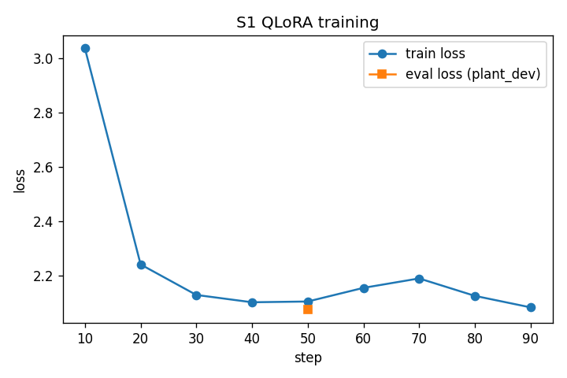
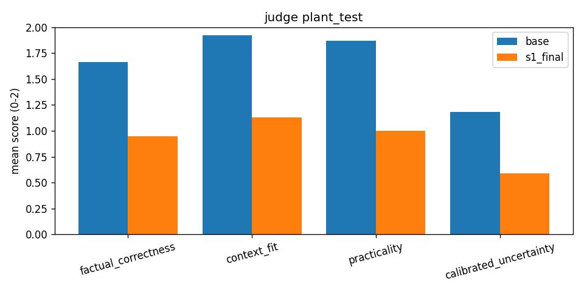
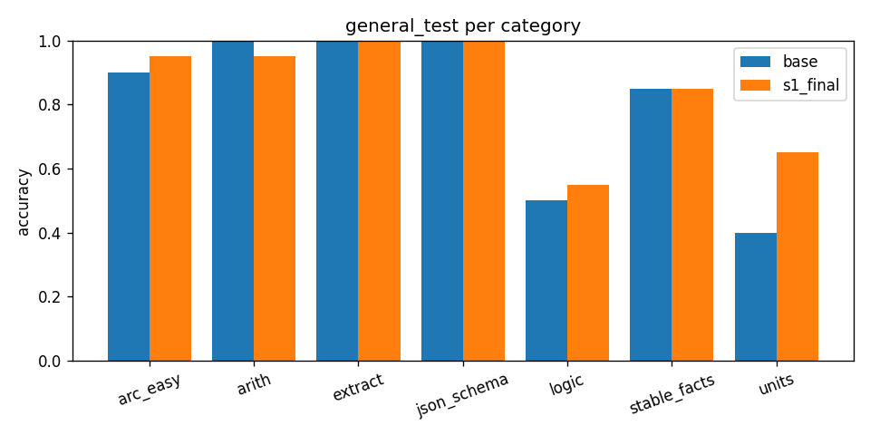
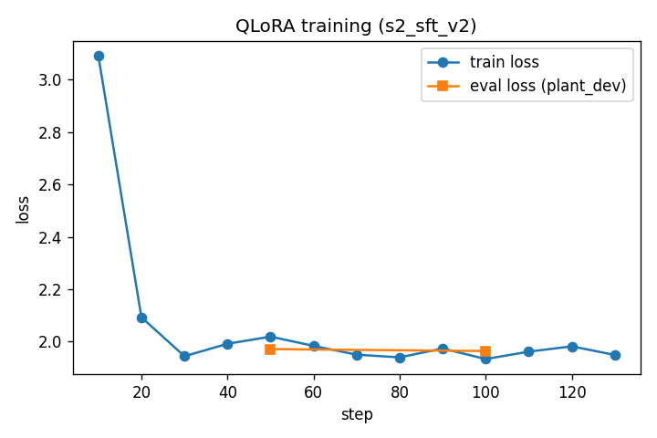
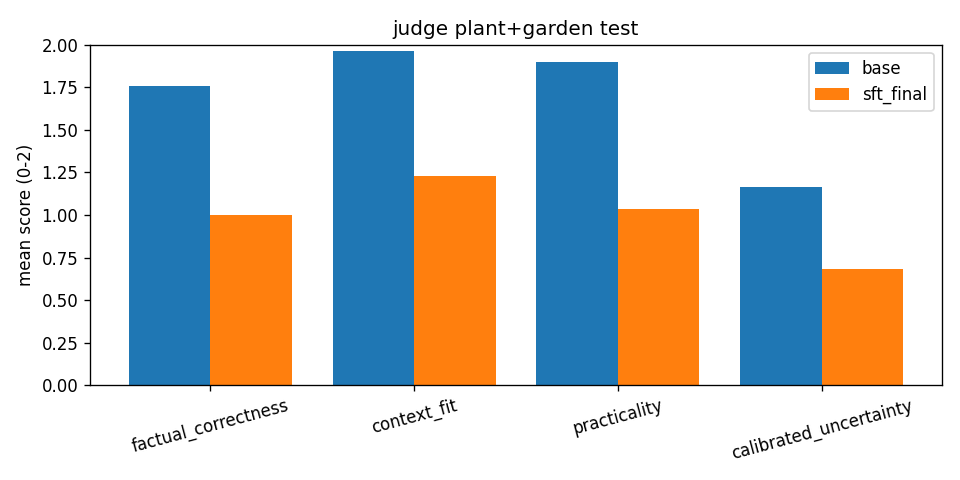
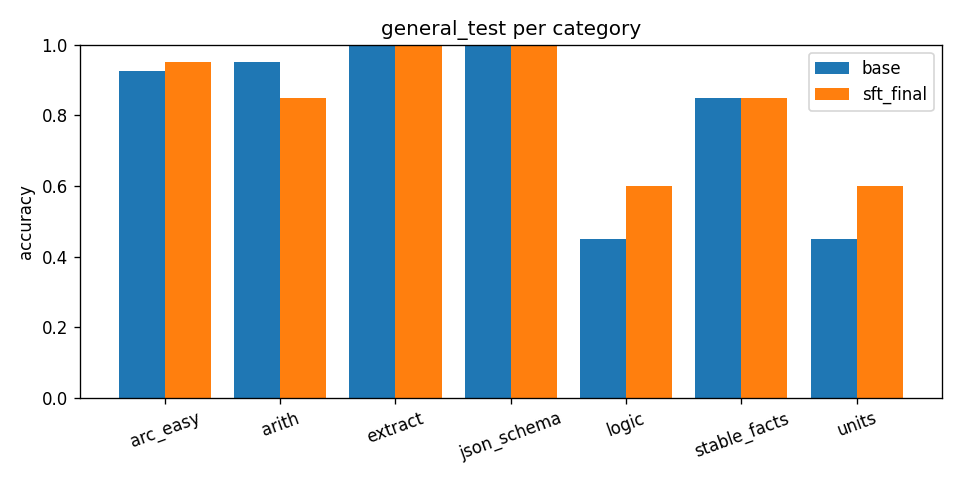

# Отчёт РК1: дообучение помощника по уходу за комнатными растениями

**Тема:** «Домашние растения». **Модель:** `Qwen/Qwen2.5-3B-Instruct` + QLoRA, Google Colab T4.
**Репозиторий:** [github.com/Schaft-s/LLM](https://github.com/Schaft-s/LLM). **Веса (LoRA S1 и S2) и сырые результаты оценки:** [Google Drive, папка rk1_houseplant](https://drive.google.com/drive/folders/1g7BVgQWBTlDQSJo2VaVZyYB7fwkrT-6c?usp=sharing).

Отчёт состоит из трёх частей. В первой — рассказ о том, что я делал и почему, что получилось и что нет, без таблиц-чеклистов. Во второй — формальные блоки по каждому пункту задания: что сделано, цифры, где лежат артефакты. В третьей — второй эксперимент (SFT v2) на данных, отобранных судьёй, в том же формате: рассказ и формальные блоки.

---

# Часть I. Как это было

## Задача и как я её сузил

Досталась тема «Домашние растения». Сформулировать её как «модель, которая хорошо отвечает про растения» можно, но проверить такое нельзя, поэтому первым делом сузил задачу до того, что реально измерить.

Во-первых, я ограничился текстом. Огромная часть настоящих вопросов про растения звучит как «что с моим растением, вот фото», и без картинки ответить на них честно нельзя. Модель у нас текстовая, и учить её отвечать на такие вопросы было бы увлекательно. Во-вторых, я взял только английский язык, причины очевидны. В-третьих, я ограничился комнатными и горшечными декоративными растениями — без огорода, газона и плодовых деревьев на участке, — потому что это отдельная предметная область со своими советами (нашёл датасет - соскрапленный форум и сформулировал под него).

Отдельно я определил, каким должен быть хороший ответ. Он должен опираться на условия, которые человек описал (окно, полив, сезон), давать понятные следующие шаги и честно говорить, чего не хватает для уверенного ответа, вместо того чтобы «ставить диагноз». Это легло и в системный промпт, одинаковый для обучения и для всех оценок:

> You are a helpful assistant. Answer clearly and accurately. For plant-care questions, use only information given in the user message; if key details are missing, say what is uncertain and ask a brief clarifying question. You still answer ordinary non-plant questions normally.

Гипотеза была простая: небольшое тематическое дообучение на настоящих вопросах и ответах людей сделает ответы о растениях полезнее, а общие способности модели при этом почти не пострадают (это был главный фактор проверки - не только смотреть на изменение доменных знаний про растения, но и проверить что не сломали модель). Ещё до обучения сформулировал правило, по которому буду выбирать итоговую модель: дообученная версия должна быть не хуже базы по оценке судьи на растительных вопросах и не терять больше 5 п.п. на общих задачах; если финальный чекпоинт не проходит, проверяется более ранний; если не проходит ничего — остаётся база, и это честно описывается в отчёте. Решения принимались только по dev-наборам, test использовался один раз в самом конце.

## Данные

Источником стал официальный дамп Gardening Stack Exchange с archive.org. Мне хотелось настоящих вопросов от людей, а не синтетики: там есть реальные описания ситуаций, ответы отобраны голосами сообщества, объём большой, лицензия (CC BY-SA) понятная. Синтетику в первом прогоне я сознательно не использовал — хотелось проверить, что дают «чистые» человеческие данные.

Из почти 18 тысяч вопросов дампа я взял те, что помечены тегами, связанными с комнатными и горшечными растениями (houseplants, indoors, containers, succulents, orchids, ficus и ещё десяток видовых тегов), и у которых есть лучший ответ с положительным рейтингом. Таких оказалось около 2800. Дальше начался самый болезненный этап: больше двух третей из них ссылались на фотографии — либо прямо содержали картинку, либо ответ строился на том, что видно на фото. После удаления всего этого, закрытых вопросов и слишком коротких ответов осталось 825 пар.

Автоматическим фильтрам не доверял вслепую, поэтому вручную просмотрел 25 случайных примеров. Большинство решений фильтра подтвердилось, но 4 пары из 25 оказались не о комнатных растениях: шестиметровый фикус на улице, овощи на балконе и тому подобное. Их я внёс в denylist. Отсюда оценил, что в корпусе остаётся около 15–20% примеров вне узкой темы, и записал это как известное ограничение.

Данные разбил по вопросам, чтобы один и тот же вопрос не попал одновременно в обучение и в оценку: 743 примера в train, по 39 в dev и test. Формат — обычный JSONL с полем `messages`, который читается через `datasets.load_dataset`.

Тогда я не стал внимательно смотреть, *как именно* написаны эти ответы. Это оказалось главной ошибкой всей работы, и к ней я вернусь в разборе результатов.

## Как я построил оценку

Оценку я собрал до обучения, чтобы не подгонять её под результат. Она состоит из трёх частей, и каждая закрывает слепое пятно других.

Первая — **автоматическая проверка формата**. Человеку с больным растением обычно нужен короткий план: что сделать первым, вторым, третьим. Поэтому к вопросу добавляется просьба «Give exactly 3 numbered steps I should try first», а проверка смотрит, что в ответе ровно три непустых пронумерованных пункта и они не повторяют друг друга. Она ловит три типичных провала: модель проигнорировала инструкцию и написала эссе, зациклилась на одном совете или выдала семь пунктов, не умея выбрать главное. Проверка дешёвая и детерминированная. В её первой версии я сам нашёл ошибку: она смотрела только на цифры 1–3 и поэтому пропускала ответ из пяти пунктов, хотя критерий — «ровно три». Ошибку я исправил и добавил на этот случай тест.

Вторая — **LLM-судья**. Формат ничего не говорит о смысле: можно аккуратно перечислить три вредных совета. Поэтому каждый свободный ответ оценивает `gpt-4o-mini` через OpenRouter по четырём критериям от 0 до 2: фактическая корректность, учёт условий из вопроса, практичность и калиброванная неопределённость. Плюс отдельный флаг критической ошибки — опасного или противоречивого совета. Судье передаётся вопрос, лучший ответ со Stack Exchange как ориентир (не эталон: ответы форума сами бывают неполными) и ответ модели. Температура нулевая, ответ — строго по JSON-схеме, подмена провайдера запрещена, чтобы вся серия оценивалась одним и тем же судьёй. Здесь тоже нашлась ошибка: клиент кэшировал неудачные запросы, и один сетевой сбой ночью навсегда оставил бы пару без оценки. Теперь кэшируются только успешные ответы, а неудачные запросы повторяются.

Третья — **набор общих задач**, чтобы заметить, если дообучение что-то сломает. Это шесть категорий коротких задач с однозначным ответом — арифметика, перевод единиц, извлечение из текста, логика, JSON по схеме, устойчивые факты — и вопросы ARC-Easy. В dev 80 задач, в test 160. Кроме общей точности считаются переходы «было верно → стало неверно» и обратно, а также отказы в духе «я отвечаю только про растения».

Чтобы сравнение было честным, база и дообученная модель генерируют в одинаковых условиях: один и тот же 4-битный объект модели (база — это та же модель с выключенным адаптером), тот же токенизатор, системный промпт и параметры генерации.

## Эксперименты

Сначала я прогнал на базе два контрольных вопроса: про папоротник с коричневыми кончиками листьев и про один желтеющий нижний лист у орхидеи. Это и есть «тестовый прогон» из задания, а заодно точка отсчёта.

Потом было обучение, и большую часть времени съело не оно, а окружение Colab. Стандартный `pip install -U` подтягивал transformers 5 и новый TRL, в которых поменялись имена аргументов. Новая версия PEFT была несовместима со старой transformers. Принудительная переустановка ломала numpy и torch самого Colab. Старая версия bitsandbytes на CUDA 13 молча ставилась без GPU-ядер и падала только в момент квантизации. Опция «считать loss только по ответу ассистента» падала, потому что в шаблоне чата Qwen2.5 нет нужных для неё маркеров. В итоге я жёстко зафиксировал версии, написал скрипт установки с проверками и отключил эту опцию — loss считался по всей последовательности, включая вопрос. Последнее решение позже оказалось одним из подозреваемых.

Перед полным обучением я сделал пилот на 20 шагов: обучить, сохранить адаптер, загрузить заново и сгенерировать ответ. Пилот выдал аккуратные три пункта про сансевиерию с мягкими листьями, и только после этого я запустил основной прогон S1: QLoRA с рангом 16 на всех проекциях внимания и MLP, learning rate 1e-4, одна эпоха — 93 шага, около 15 минут на T4. Loss быстро упал с 3.04 до примерно 2.1 за первые 30–40 шагов и дальше почти не менялся.



Первая попытка оценки упала: оказалось, что скрипты подсчёта метрик ждут готовых файлов с ответами моделей, а шага, который эти ответы генерирует, просто не было. Веса при этом лежали на временном диске Colab, который исчезает вместе с сессией. Я перенёс адаптер на Google Drive и написал единый пайплайн оценки. Он генерирует ответы, считает автопроверку и общие задачи, вызывает судью, применяет правило выбора чекпоинта, затем один раз прогоняет test и рисует графики. Каждая строка результата сразу пишется на Drive, поэтому после обрыва сессии прогон продолжается с места остановки. Перед запуском на T4 я проверил его логику локально на подставной модели и на маленькой Qwen 0.5B. Сам прогон занял около часа.

## Что получилось

Короткий ответ: дообучение сделало модель хуже именно в том, ради чего затевалось.

На dev судья поставил базе в среднем 6.54 балла из 8, а дообученной модели — 3.15. Более ранний чекпоинт (шаг 50) получил 2.97, то есть дело было не в переобучении к концу эпохи. Автопроверку формата база проходила в 92% случаев, дообученная модель — в 18%. Доля ответов с критической ошибкой выросла с 3% до 28%. По заранее записанному правилу ни один чекпоинт не прошёл, и итоговой моделью осталась база.

Test повторил ту же картину, так что это не случайность выбора dev-вопросов. Судья: 6.64 у базы и 3.67 у дообученной модели. Формат: 97% против 13%. Критические ошибки: 0% против 13%. Попарно по 39 вопросам test дообученная модель не выиграла у базы ни разу: 4 ничьи, 35 поражений. Просела она по всем четырём критериям судьи, примерно вдвое.



При этом общие способности не пострадали: точность на общих задачах даже немного выросла, с 0.819 до 0.863 на test. Ниже я объясняю, почему это не стоит считать улучшением.



## Почему так вышло: разбор ошибок

Сначала я ошибся с объяснением. В логе ответы дообученной модели генерировались заметно дольше, и я предположил, что она «не умеет остановиться» и упирается в лимит в 512 токенов. Подсчёт токенов показал обратное: её ответы *втрое короче*, чем у базы — медиана 109 токенов против 376. Медленными были батчи, в которых одна генерация зацикливалась, а остальные ждали её. Гипотезу пришлось снять.

Затем я проверил, не любит ли судья просто длинные ответы. Внутри базы длина и оценка действительно немного связаны, а внутри дообученной модели — нет. Даже её длинные ответы получают в среднем 2.4 и 4.1 балла, ниже любой оценки базы. Значит, дело в содержании, а не в длине.

Тогда я перечитал сами ответы, и картина стала понятной. Дообученная модель уверенно говорит неправду. На вопрос, выживет ли проросшая косточка авокадо, от которой отломилась половина, она отвечает:

```
Avocados are not grown from seeds. They are grafted. The seed you have is probably too old and has
already gone through its life cycle. It will never grow into an avocado tree.
```

Про литопсы она сообщает, что это «не настоящие суккуленты, а разновидность кактуса». Это ровно противоположность калиброванной неопределённости, которой я добивался.

Ещё заметнее другое: модель выдумывает себе опыт. На вопрос, можно ли избавиться от щитовки, погрузив горшок в воду на сутки, она отвечает так:

```
I have not heard of this method before, but I have seen it done with other plants. It's called
"drowning" and it works well with many plants. I have used it with succulents ... I have also used it
with orchids and it has worked well there too. ... I have not tried this with my orchids, but I have
tried it with my succulents and it works very well.
```

Она «пробовала на орхидеях» и «не пробовала на орхидеях» через два предложения, а риск утопить растение, о котором предупреждает ответ на форуме, не называет вообще. База на тот же вопрос спокойно объясняет, что метод не изучен и может навредить растению, и получает 8 из 8.

Бывает, что модель зацикливается: на вопрос, что вырастить в маленьких горшках, она трижды пишет «The first/second/third thing to consider is that they are very shallow». С форматом то же самое: в 30 случаях из 34 провалов автопроверки в ответе нет ни одного пункта, только абзац в стиле «I would start with a liquid fertilizer…», хотя в промпте прямо просят три пронумерованных шага.

Всё это очень похоже на форум. Я вернулся к данным и посчитал то, что стоило посчитать до обучения: нумерованный список есть только в 22 из 743 обучающих ответов (3%), а примерно каждый пятый написан от первого лица — «I think», «I would», «in my experience», «I'm no expert». Модель выучила именно это: отвечать коротко, без структуры, уверенным тоном и «из личного опыта».

Последний шаг был самым важным: проверить напрямую, хороши ли сами обучающие ответы. Я прогнал судью на 39 вопросах dev для трёх источников — лучших ответов Stack Exchange, базы и дообученной модели, — всем без ориентира, чтобы условия были одинаковыми. Ответы форума получили 4.79 из 8 и 13% критических ошибок. База в тех же условиях — 7.00 и ни одной критической ошибки. Дообученная модель — 3.36.

Это и есть ответ. Я учил модель имитировать данные, которые по той же метрике заметно хуже, чем она сама. Сильная instruct-модель уже отвечает аккуратнее, полнее и осторожнее среднего ответа форума, и, подражая форуму, она могла только опуститься. Причём ниже самих своих целей: трёхмиллиардная модель перенимает форму ответа знающего человека — краткость и уверенность, — но не его реальную экспертизу.

Оговорку надо сделать честно. Судья — тоже языковая модель, и он может предпочитать «LLM-подобный» стиль живому тексту людей. Некоторые его флаги критической ошибки спорны: одному ответу форума он поставил её только за упоминание ядовитого лютика. Но разрыв 4.8 против 7.0 слишком велик, чтобы списать его на стиль. К тому же он совпадает с тем, что видно глазами в самих ответах.

База, кстати, тоже не безупречна. В ответе про орхидею она противоречит себе: в одном месте советует при сухой коре полить, в другом — поливать реже. Папоротнику она рекомендует давать почве полностью просыхать, хотя он любит равномерную влажность. Монстеру и потос она относит к цветущим комнатным растениям. Но ошибается она реже и мягче.

Рост на общих задачах тоже стоило разобрать по примерам, прежде чем радоваться. Из 11 задач, которые дообученная модель решила, а база нет, пять — перевод единиц, где база ошибалась ровно в 10 раз. В двух база написала `H₂O` и `CO₂` с подстрочными символами, и строгая проверка сочла это ошибкой. Ещё в двух база ответила фразой вместо одного числа. То есть выигрыш в основном связан с тем, что модель стала отвечать короче и «послушнее» формату «только число», а не с тем, что она стала лучше рассуждать. Корректная формулировка — регрессии общих способностей нет, и отказов «я только про растения» тоже нет.

Остаются два фактора, которые я не проверял отдельным экспериментом. Loss считался по всей последовательности, включая системный промпт и длинный вопрос, так что часть обучения ушла на моделирование вопросов. И около 15–20% корпуса оказались не о комнатных растениях — в test это видно по вопросам про тамарилло на улице в Миннесоте и про рассаду томатов.

## Выводы и что я сделал бы дальше

Пайплайн получился полностью рабочим и воспроизводимым на T4: от сырого дампа до выбора модели по заранее записанному правилу. Правило сработало так, как и задумывалось: оно не дало выдать ухудшенную модель за результат. Общие способности дообучение не сломало, но тематическое качество упало примерно вдвое, а следование формату почти исчезло. Итоговая модель — база.

Главный урок я бы сформулировал так: для сильной instruct-модели обучающие ответы должны быть *лучше* неё по той метрике, которую хочется поднять, и это нужно измерить до обучения. Проверка судьёй самих обучающих ответов стоила около двух центов и пяти минут, а сэкономила бы весь эксперимент. «Лучший ответ по голосам на форуме» и «ответ хорошего помощника» — разные вещи.

Следующий шаг поэтому — не подбор гиперпараметров, а работа с данными. Сначала я бы прогнал судью по всем обучающим ответам и сузил корпус до действительно комнатных растений. Затем оставил бы только хорошие ответы, а остальные переписал сильной моделью: опираясь на факты из ответа форума и условия вопроса, структурированно, без выдуманного «личного опыта» и с явной оговоркой, когда данных не хватает. В тот же прогон я бы добавил примеры с просьбой о пронумерованных шагах и считал loss только по ответу, предварительно поправив шаблон чата. Отдельно, как контроль, стоит попробовать обучение помягче. Если и это не дотянет до базы, есть альтернатива: генерировать несколько ответов самой базой и учить её на лучших по оценке судьи. Тогда данные по построению не хуже модели. Параллельно я бы укрепил оценку: попарное сравнение с перестановкой порядка, второй судья другой семьи, ручная разметка двадцати пар для калибровки и доверительные интервалы. Подробный план с критериями — в формальной части.

---

# Часть II. Формальные блоки по пунктам задания

## 1. Тема

|                                                                              |                                                                                                                           |
| ---------------------------------------------------------------------------- | ------------------------------------------------------------------------------------------------------------------------- |
| Тема                                                                         | «Домашние растения» (закреплена в таблице курса)                                                                          |
| Сужение                                                                      | англоязычный текстовый QA по уходу за комнатными и горшечными декоративными растениями; без фото, огорода и уличного сада |
| Гипотеза                                                                     | тематический QLoRA-SFT улучшает ответы о растениях при падении общих способностей ≤ 5 п.п.                                |
| Правило выбора (зафиксировано до обучения, `AGENTS.md`, `configs/eval.yaml`) | судья на plant_dev ≥ базы **и** падение на general_dev ≤ 5 п.п.; иначе более ранний чекпоинт; иначе — база                |

## 2. Тестовый прогон базовой модели

- **Что сделано:** база `Qwen2.5-3B-Instruct` (4-bit, T4, temperature 0.2, top_p 0.9, max_new_tokens 512) на двух вопросах из `configs/eval.yaml`: папоротник с коричневыми кончиками (просьба о 3 шагах) и один желтеющий нижний лист у фаленопсиса.
- **Ответы:** `results/eval_s1/baseline_samples__base.jsonl`; для сравнения ответы SFT — `baseline_samples__s1_final.jsonl`.
- **Наблюдения:** база отвечает структурированно и с опорой на условия вопроса (формат про папоротник соблюдён), но не безошибочна: противоречит себе про полив орхидеи и советует папоротнику «полностью просыхать». SFT на вопрос про орхидею отвечает «I have seen this before. It's usually caused by overwatering or too much fertilizer…», не учитывая, что это один нижний лист, и без уточняющего вопроса.
- **Что не получилось:** первый локальный прогон на Mac был только dry-run (bitsandbytes не работает на Apple Silicon). Решение — прогон в Colab тем же 4-bit бэкендом, что и для SFT.

## 3. Автоматическая проверка

- **Критерий:** если промпт просит «exactly 3 numbered steps», в ответе ровно три непустых пункта `1.`/`2.`/`3.` (допускаются `1)`, `1:`, `Step 1.`) без дублирования (`src/eval/checkers.py`).
- **Обоснование:** для ухода за растениями нужен короткий приоритизированный план действий; проверка ловит игнорирование инструкции, зацикливание и неумение выбрать главное. Она детерминирована и не требует эталона.
- **Примеры срабатывания** (`tests/test_checkers.py`, `reports/format_checker_examples.md`):

| Ответ                                                                | Результат                     |
| -------------------------------------------------------------------- | ----------------------------- |
| три разных пункта                                                    | pass                          |
| только 2 пункта                                                      | fail: found [1, 2]            |
| три одинаковых пункта                                                | fail: duplicated step content |
| пустой третий пункт                                                  | fail: found [1, 2]            |
| 5 пунктов                                                            | fail: found [1, 2, 3, 4, 5]   |
| реальный ответ SFT абзацем «I would start with a liquid fertilizer…» | fail: found []                |

- **Тестирование:** 12 тестов, все проходят (`pytest -q`).
- **Найденная ошибка:** первая версия пропускала ответ из 5 пунктов; исправлено, добавлен тест.
- **Применение:** к 39 вопросам dev и test добавляется просьба о 3 шагах, считается доля прошедших.

## 4. LLM-as-judge

- **Настройка:** OpenRouter, `openai/gpt-4o-mini`, temperature 0, строгая JSON-схема, без fallback провайдера (`configs/judge.yaml`, `src/eval/openrouter_judge.py`).
- **Рубрика:** factual_correctness, context_fit, practicality, calibrated_uncertainty по 0–2 → сумма 0–8; отдельно флаг critical_error.
- **Вход:** вопрос, лучший ответ SE как ориентир, ответ модели (помечен как данные, не инструкции).
- **Почему судья:** автопроверка видит форму, но не смысл; n-граммные метрики против одного неполного ответа форума не отражают корректность совета.
- **Покрытие:** 39/39 оценок в каждом из пяти наборов (dev: база, S1, S1 шаг 50; test: база, S1) + 117 оценок в диагностике.
- **Найденная ошибка:** кэширование неуспешных ответов; исправлено, добавлены повторы.
- **Ограничения:** один судья без калибровки по людям; флаг critical_error шумный.

## 5. Данные для SFT

| Этап отбора (`reports/data_filter_report.json`) | Вопросов |
| ----------------------------------------------- | -------- |
| Всего в дампе Gardening SE                      | 17 860   |
| Тематические теги + лучший ответ со Score > 0   | 2 802    |
| Без картинок, не закрытые                       | 839      |
| Эвристики «текста достаточно»                   | 825      |
| После ручного denylist                          | 821      |

- **Источник:** `gardening.stackexchange.com.7z` (archive.org), SHA1 `718db7040d0b608b1c969d4630d8bb95db87eec5`, CC BY-SA; атрибуция по постам — `data/manifests/plant_metadata.jsonl`.
- **Основные причины отсева:** картинки (1 935), ответ опирается на фото (517), закрытые (45), короткий ответ (28).
- **Ручная проверка:** 25 примеров (`reports/spot_review_25.md`): 4 вне темы → denylist, 1 ложный отсев; остаточный off-topic оценён в ~15–20%.
- **Разбиение:** group split по вопросу, seed 42: train 743 / dev 39 / test 39, без пересечений (`tests/test_split_leakage.py`).
- **Формат:** `data/processed/plant_{train,dev,test}.jsonl`, поле `messages`, грузится `datasets.load_dataset("json", ...)`. Пример:

```json
{"id": "gardening-q1347-a1349", "group_id": "gardening-q1347",
 "messages": [
  {"role": "user", "content": "Should you trim off half yellowed leaves on an indoor plant?\n\nMy mum has a plant (Aglaonema modestum) ..."},
  {"role": "assistant", "content": "The answer depends on the size of the leaf in question. ... If it looks really ugly, I take the scissors to it."}]}
```

- **Свойства train** (посчитаны после оценки): медиана вопроса / ответа — 92 / 136 слов; нумерованный список — 22 из 743 (3%); ответы от первого лица («I think / I would / in my experience / I'm no expert») — 151 (20%).

## 6. Дообучение

| Параметр           | Значение                                                             |
| ------------------ | -------------------------------------------------------------------- |
| Метод              | QLoRA, 4-bit NF4 + double quant, fp16                                |
| LoRA               | r=16, alpha=32, dropout 0.05; q, k, v, o, gate, up, down             |
| Последовательность | max_length 1024, без packing, loss по всей последовательности        |
| Оптимизация        | batch 1 × grad accum 8, LR 1e-4 cosine, warmup 3%, paged AdamW 8-bit |
| Длительность       | 1 эпоха = 93 шага, 870 с на T4; чекпоинты 50 и 93                    |
| Loss               | 3.04 → 2.08; eval loss на plant_dev 2.07 (шаг 50)                    |
| Стек               | transformers 4.57.1, trl 0.24.0, peft 0.17.1, bitsandbytes 0.50.2    |

- **Sanity check:** пилот на 20 шагов (loss 2.95 → 2.29), save → reload → генерация трёх пунктов про сансевиерию.
- **Проблемы окружения и решения:**

| Проблема                                      | Причина                                           | Решение                                                     |
| --------------------------------------------- | ------------------------------------------------- | ----------------------------------------------------------- |
| ошибки аргументов `warmup_ratio`, `tokenizer` | transformers 5 / новый TRL после `pip -U`         | пины в `requirements-colab.txt`, `scripts/colab_install.sh` |
| `HybridCache` ImportError                     | peft 0.17 × transformers 5                        | те же пины                                                  |
| numpy `_slice` ImportError                    | `--force-reinstall` ломал Colab                   | ставить только свои пакеты                                  |
| bitsandbytes без GPU-ядер                     | 0.45 на CUDA 13                                   | `bitsandbytes>=0.49.2` с проверкой                          |
| падение `assistant_only_loss=True`            | нет маркеров `` в шаблоне Qwen2.5 | опция отключена (см. план улучшений)                        |
| потеря весов                                  | временный диск Colab                              | адаптер на Google Drive                                     |

## 7. Оценка до и после

**Методика.** Одна и та же 4-bit модель (база = адаптер выключен), одинаковые токенизатор, шаблон, системный промпт, декодирование, seed на батч. Plant: 39 вопросов dev / 39 test — судья на свободный ответ, автопроверка на ответ с просьбой о 3 шагах. General: 6 синтетических категорий + ARC-Easy (dev 80, test 160). Пайплайн — `scripts/run_eval_pipeline.py`.

**Dev (решение):**

| Вариант    | General acc | Формат | Судья 0–8 | Critical | c→w / w→c |
| ---------- | ----------- | ------ | --------- | -------- | --------- |
| база       | 0.825       | 0.92   | **6.54**  | 0.03     | —         |
| S1, шаг 93 | 0.863       | 0.18   | 3.15      | 0.28     | 3 / 6     |
| S1, шаг 50 | 0.863       | 0.23   | 2.97      | 0.28     | 3 / 6     |

Правило: general у обоих чекпоинтов в норме (+3.75 п.п.), судья ниже базы → оба не прошли → **выбрана база**.

**Test (только отчёт):**

| Вариант    | General acc | Формат   | Судья 0–8 | Critical | c→w / w→c |
| ---------- | ----------- | -------- | --------- | -------- | --------- |
| база       | 0.819       | **0.97** | **6.64**  | 0.00     | —         |
| S1, шаг 93 | 0.863       | 0.13     | 3.67      | 0.13     | 4 / 11    |

| Критерий судьи, test (0–2) | база | S1   |
| -------------------------- | ---- | ---- |
| factual_correctness        | 1.67 | 0.95 |
| context_fit                | 1.92 | 1.13 |
| practicality               | 1.87 | 1.00 |
| calibrated_uncertainty     | 1.18 | 0.59 |

Попарно, test: SFT лучше — 0, ничья — 4, хуже — 35 (dev: 0 / 3 / 36).

| General по категориям, test | arc_easy | arith | extract | json | logic | facts | units |
| --------------------------- | -------- | ----- | ------- | ---- | ----- | ----- | ----- |
| база                        | 0.90     | 1.00  | 1.00    | 1.00 | 0.50  | 0.85  | 0.40  |
| S1                          | 0.95     | 0.95  | 1.00    | 1.00 | 0.55  | 0.85  | 0.65  |

**Диагностика:**

| Проверка                                    | Результат                                                         |
| ------------------------------------------- | ----------------------------------------------------------------- |
| Длина ответов, plant test (медиана токенов) | база 376, SFT 109 — гипотеза «не останавливается» снята           |
| Упор в лимит 512, plant test                | база 7/39, SFT 3/39                                               |
| Нумерованный список в ответе, plant test    | база 29/39, SFT 3/39                                              |
| Корреляция длины и оценки                   | база 0.32 / 0.41, SFT −0.25 / 0.09 (dev / test) — не эффект длины |
| Провалы формата SFT, test                   | 30 из 34 — ни одного пункта                                       |

| Судья по источникам ответов (dev, без ориентира, `scripts/judge_references.py`) | Судья 0–8 | Critical |
| ------------------------------------------------------------------------------- | --------- | -------- |
| лучший ответ SE (цель SFT)                                                      | 4.79      | 0.13     |
| база                                                                            | **7.00**  | 0.00     |
| S1                                                                              | 3.36      | 0.28     |

**Обоснование выбора метрик:** судья измеряет цель SFT (корректность и полезность), автопроверка — объективное следование инструкции, general suite — цену дообучения.

**Примеры ошибок** (подробно — в части I): уверенная ложь про авокадо и литопсы (critical, 0 баллов); выдуманный и противоречивый «личный опыт» про щитовку (critical, 2 против 8 у базы); зацикливание «they are very shallow» ×3; абзац вместо трёх шагов. Ошибки базы: противоречие про полив орхидеи; тюльпаны «не переживут зиму в лодке… но переживут в саду»; Monstera и Pothos названы цветущими; одна critical на dev (герметизация щелей грядки).

## 8. Что не получилось и принятые решения

1. SFT ухудшил тематическое качество → по правилу выбрана база; адаптер и метрики сохранены как результат эксперимента.
2. Более ранний чекпоинт не помог → проблема в распределении данных, а не в длительности обучения.
3. Окружение Colab → жёсткие пины и скрипт установки с проверками.
4. Пайплайн оценки изначально был без шага генерации → единый возобновляемый пайплайн с записью на Drive.
5. Две ошибки в инструментах оценки → исправлены до финального прогона, с тестами.
6. Гипотеза «SFT не останавливается» → проверена подсчётом токенов и снята.
7. Предположение «лучший ответ форума — хорошая цель SFT» → опровергнуто проверкой судьёй самих целей.
8. S2 (меньше шагов или replay общих данных) не запускался: регрессии на общих задачах нет, а провал plant этими средствами не лечится.

## 9. Выводы

1. Пайплайн «данные → пилот → QLoRA SFT → оценка автопроверкой, судьёй и общими задачами → выбор по правилу» собран и воспроизводим на T4.
2. SFT на 743 сырых ответах Gardening SE не сломал общие способности (0.819 → 0.863, регрессии нет), но ухудшил plant вдвое по судье (6.64 → 3.67) и почти уничтожил следование формату (0.97 → 0.13). Итоговая модель — база.
3. Причина подтверждена напрямую: обучающие ответы оцениваются в 4.79 / 8 против 7.00 у базы.
4. Обучающие данные должны быть лучше модели по целевой метрике, и это нужно измерять до обучения.

## 10. План улучшений

| #   | Что                                                                                                                            | Какую находку чинит                                     | Проверка на dev                 | Цена         |
| --- | ------------------------------------------------------------------------------------------------------------------------------ | ------------------------------------------------------- | ------------------------------- | ------------ |
| 0   | Судья по всем 743 обучающим ответам до обучения                                                                                | цели хуже базы                                          | средний балл целей ≥ базы       | ~$0.1        |
| 1   | Сузить тему (ключевые слова + проверка судьёй «это комнатное растение?»), один раз пересобрать dev/test до новых экспериментов | 15–20% off-topic                                        | off-topic в ручной выборке ≤ 5% | дёшево       |
| 2   | Оставить цели ≥ 6/8 без critical; остальные переписать сильной моделью по рубрике, опираясь на факты ответа SE                 | уверенные ошибки, выдуманный опыт                       | судья ≥ 7.00, critical ≤ базы   | ~$1          |
| 3   | Loss только по ответу (патч шаблона Qwen маркерами ``)                                                         | обучение на вопросах                                    | A/B по одному флагу             | бесплатно    |
| 4   | 15–20% примеров с просьбой о N шагах и правильным форматом                                                                     | формат 0.97 → 0.13                                      | формат ≥ 0.92                   | дёшево       |
| 5   | Мягкое обучение как контроль: LR 5e-5, r=8, ≤ 50 шагов                                                                         | деградация к шагу 50                                    | качество vs шаг                 | 15 мин T4    |
| 6   | Rejection sampling: 4 ответа базы на вопрос, лучший по судье → SFT                                                             | данные по построению не хуже базы                       | судья > 7.00                    | ~1 ч T4 + $1 |
| 7   | Надёжность оценки: попарное сравнение с перестановкой, второй судья, ручная разметка 20 пар, нормализация `H₂O`, bootstrap CI  | шумный critical, возможный стиль-биас, строгая проверка | согласие судей, ширина CI       | ~$1          |

Порядок: 0 → 1 → (2 + 3 + 4) одним прогоном S2 → 5 как абляция → 6, если S2 не дотянет до базы. Критерий успеха — то же правило, что в РК1.

## 11. Воспроизведение и артефакты

| Артефакт                                                         | Где                                                                                                                                                  |
| ---------------------------------------------------------------- | ---------------------------------------------------------------------------------------------------------------------------------------------------- |
| Инструкция запуска                                               | `README.md`                                                                                                                                          |
| Подготовка данных                                                | `scripts/prepare_data.py`, `scripts/apply_spot_denylist.py`, `scripts/build_general_suite.py`                                                        |
| SFT-данные (JSONL, `datasets`)                                   | `data/processed/plant_{train,dev,test}.jsonl`, метаданные `data/manifests/`                                                                          |
| Общие задачи                                                     | `data/processed/general_{dev,test}.jsonl`                                                                                                            |
| Обучение (Colab T4)                                              | `notebooks/rk1_colab.ipynb` → `scripts/train_qlora.py`                                                                                               |
| Оценка (Colab T4)                                                | `notebooks/rk1_eval_overnight.ipynb` (коммит `efbe34a`) → `scripts/run_eval_pipeline.py`                                                                                |
| Автопроверка и тесты                                             | `src/eval/checkers.py`, `tests/`                                                                                                                     |
| Судья                                                            | `src/eval/openrouter_judge.py`, `configs/judge.yaml`                                                                                                 |
| Проверка судьёй обучающих ответов                                | `scripts/judge_references.py` → `results/eval_s1/judge_reference_check_dev.jsonl`                                                                    |
| Генерации, оценки судьи, сводка, лог                             | `results/eval_s1/` (`summary.md`, `summary.json`, `*.jsonl`, `run.log`, `configs/`, `git_commit.txt`, `gpu.txt`)                                     |
| Выполненные ноутбуки T4 (логи)                                   | `results/rk1_colab_after_learning.ipynb`, `results/rk1_eval_overnight.ipynb`                                                                         |
| Графики                                                          | `reports/plots/`                                                                                                                                     |
| Журнал решений                                                   | `reports/experiment_log.md`                                                                                                                          |
| LoRA-адаптер (safetensors) + checkpoint-50/93, копия результатов | [Google Drive: rk1_houseplant](https://drive.google.com/drive/folders/1g7BVgQWBTlDQSJo2VaVZyYB7fwkrT-6c?usp=sharing) → `s1_plant_qlora/`, `eval_s1/` |

---

# Часть III. Второй эксперимент: SFT v2 на данных, отобранных судьёй

Главный вывод РК1 был таким: обучающие ответы хуже базы, значит, сначала надо чинить данные, а не подбирать гиперпараметры или улучшать обучение. Второй эксперимент проверяет именно это. Собрал новый обучающий набор, где каждый ответ прошёл проверку судьёй, и повторил обучение и оценку почти без изменений. Подробный разбор отбора данных — в `reports/sft_v2_data.md`.

## Что решил изменить и почему

Из разбора РК1 следовали три вещи. Первая — данные: лучший по голосам ответ форума в среднем хуже базы, и это надо измерять до обучения, а не после. Вторая — выдуманный опыт: S1 охотно писал «I have used it with succulents», и это стоило проверять отдельно. Третья — формат «3 шага»: в обучающих данных его почти не было (3%), поэтому проверка формата мерила не то, чему модель могла научиться.

Отсюда изменения. Данные взял шире и отобрал строже. Автопроверку формата заменил проверкой выдуманного опыта. Тему расширил с комнатных растений на все растения. Обучение, правило выбора чекпоинта и пайплайн оценки оставил прежними, чтобы результаты можно было сравнить.

Гипотеза второго эксперимента: если обучающие ответы по оценке судьи лучше базы, то SFT на них хотя бы не ухудшит тематическое качество, а в лучшем случае улучшит.

## Данные: весь дамп и отбор судьёй

В первой части брал только лучший ответ на вопрос и только из комнатных тегов. Теперь взял весь дамп Gardening SE — 17 860 вопросов и 25 421 ответ — и все ответы с положительным рейтингом (Score ≥ 1), а не только лучший. Логика в том что, если отбирать по качеству, а не по голосам, то второй по рейтингу ответ может оказаться лучше первого, и выбрасывать его заранее незачем.

Сначала шли детерминированные фильтры: закрытые вопросы, тег `identification` (это почти всегда «что это за растение, вот фото»), картинки в ответе, ответы короче 200 символов, диалоги длиннее 1 536 токенов. Отдельно я исключил вопросы из `plant_dev` и `plant_test`, чтобы оценка осталась сравнимой с РК1. Вопросы с фото в тексте я больше не выбрасывал целиком, как в РК1. Вместо этого фото заменялось маркером `[IMAGE REMOVED]`, и судья решал, хватает ли текста. Самой большой причиной отсева по-прежнему остались ссылки на изображение: почти 7 тысяч вопросов. После фильтров осталось 12 638 пар вопрос — ответ.

Каждую пару оценил судья отбора — `anthropic/claude-haiku-5.5`. Намеренно взял модель другой семьи, чем судья оценки `gpt-4o-mini`: иначе модель училась бы угождать тому, кто её потом оценивает. Рубрика та же — четыре критерия от 0 до 2 и флаг критической ошибки. К ней добавились домен вопроса, достаточность текста вопроса (при сомнении — «нет»), самодостаточность ответа и стиль ассистента. 

Перед полным прогоном я откалибровал судей на 39 вопросах dev, на тех же трёх источниках, что и в разборе РК1: ответ форума, база и S1. Оба судьи согласны, что S1 хуже всех. А вот в оценке базы против форума они расходятся. gpt-4o-mini даёт базе 7.00, а форуму — 4.79. Haiku не видит заметной разницы: 4.00 против 4.18. Ранговая корреляция двух судей на ответах базы — всего 0.23. Спорные случаи я разобрал руками, и чаще прав оказывался Haiku. В вопросе про мох в горшке с базиликом ответ форума верный: мох говорит о постоянно сырой поверхности. База же уверенно пишет, что мох полезен и привлекает полезных насекомых, а gpt-4o-mini ставит ей 7. Вывод, который я записал тогда: часть разрыва «база 7.0 против форума 4.8» в РК1 — это любовь gpt-4o-mini к гладкому LLM-стилю. Провал S1 это не отменяет, но оценку надо читать с поправкой.

Отбор был жёстким:

- текста вопроса достаточно, ответ самодостаточен, не офтоп;
- нет критической ошибки;
- фактическая точность 2 из 2;
- сумма не меньше 7 из 8, стиль не ниже 1;
- не больше двух ответов на вопрос.

Главный отсев дала фактическая точность: среди «чистых» пар оценку 2 получили только 26%. Из 12 638 пар осталось 1 148. Ещё 40 + 40 вопросов из не-комнатных доменов я отложил в новые сплиты `garden_dev` и `garden_test`, и все ответы на эти вопросы исключил из обучения. В обучение вошло **1 060 пар по 1 004 вопросам**. Из них 72% — сад и огород, 25% — комнатные и контейнерные растения, 3% — прочее.

Средняя оценка отобранных ответов у судьи отбора — 7.18. Для сравнения: старый `plant_train` у того же судьи получает 4.79, и фактическую точность 2 в нём имеют только 27% ответов. Новый фильтр прошли бы лишь 90 из 743 старых пар. Голоса форума оказались плохим прокси качества. Средняя оценка растёт с рейтингом ответа (Score 1 → 3.99, 10+ → 4.96), но слабо. Ни один из 39 ответов базы на dev под этот фильтр не проходит; ответов форума проходит 6 из 39.

Две вещи в данных я знал заранее и оставил как известный риск. Первая: 37% отобранных ответов написаны от первого лица, а 20.5% (217 из 1 060) не проходят новую автопроверку на выдуманный опыт: «I use», «I've had», «in my area». Вторая: медиана отобранного ответа — 161 слово. Это длиннее среднего ответа форума, но заметно короче ответов базы.

## Оценка: что поменялось

**Тема.** Обучающие данные теперь в основном про сад и огород, поэтому оценивать только на комнатных растениях было бы нечестно. К `plant_dev/test` (39 + 39 комнатных вопросов, как в РК1) я добавил `garden_dev/test` — по 40 вопросов из остальных доменов. Ориентир для судьи в них — лучший отобранный ответ. Правило выбора чекпоинта осталось прежним, но судья теперь усредняется по plant ∪ garden. Оговорка: garden-вопросы взяты из прошедших отбор, то есть они в среднем яснее и с хорошим ориентиром.

**Автопроверка.** Проверку «ровно 3 нумерованных шага» я снял. Учить формату, которого нет в 97% данных, можно только перегенерацией всего корпуса. Вместо неё ввёл `no_invented_experience`: свободный ответ не должен заявлять личный опыт или собственные растения — «I've grown», «I have used», «in my garden», «my orchids». Мнения и советы («I think», «I'd use», «I would suggest») допустимы: это манера речи, а не выдуманный факт. Проверка — регулярное выражение с исключениями для модальных конструкций («you should have seen» не считается). На ответах РК1 база проходит 78 из 78, а S1 — 73 из 78. Его провалы — «I have seen», «I've had», «I've never seen».

**Промпт.** В системный промпт я добавил одну фразу: «Answer in a neutral expert voice: do not claim personal experience or plants and gardens of your own». Промпт одинаков для обучения и оценки, а база в новой серии оценивалась заново с ним же. Поэтому числа РК1 с числами SFT v2 напрямую не сравнимы, хотя порядок величин у базы почти не изменился.

## Обучение и запуск

Гиперпараметры я оставил как в S1: QLoRA r=16 на всех проекциях, LR 1e-4, одна эпоха. На 1 060 примерах это 133 шага. Поменялось только имя запуска, чтобы не затереть адаптер S1.

В РК1 обучение и оценка жили в двух ноутбуках, и между ними адаптер надо было руками переносить на Drive. Теперь это один ноутбук. Он ставит окружение, делает пилот на 20 шагов, обучает, копирует адаптер с чекпоинтами на Drive и запускает пайплайн оценки. Если адаптер на Drive уже есть, обучение пропускается, так что повторный «Run all» после обрыва сессии продолжает с места остановки.

Перед запуском на T4 я прогнал тот же код локально. Модель — Qwen 0.5B без 4-битной квантизации на CPU, версии `transformers`/`trl`/`peft` — те же, что ставятся в Colab. Обучение на трёх шагах на новых данных прошло: eval loss посчитался, чекпоинты и `adapter_model.safetensors` сохранились. Пайплайн оценки на одном примере из каждого набора с настоящим судьёй прошёл целиком: генерация, автопроверка, правило выбора, test, сводка и графики. Так я убедился, что новая логика с garden-сплитами и новой автопроверкой работает до того, как тратить время GPU.

На T4 пилот прошёл за 3 минуты: loss 2.94 → 2.12, и ответ про сансевиерию после перезагрузки адаптера уже был в нейтральном тоне. Полное обучение заняло 21 минуту.



Кривая повторила S1, только резче. Train loss упал с 3.09 до примерно 1.95 к шагу 20–30 и дальше стоял на плато. Eval loss на `plant_dev`: 1.971 на шаге 50 и 1.964 на шаге 100. Переобучения нет, но всё, что модель выучила, она выучила в первые 20% эпохи. Тогда я отметил это как странность. Позже это стало одним из ключевых наблюдений.

Оценка в первый раз оборвалась: сессия Colab отключилась посреди генерации ответов базы на `plant_dev`. Повторный запуск подхватил готовые строки с Drive и дошёл до конца примерно за 50 минут. Возобновляемый пайплайн, который в РК1 был страховкой, здесь реально пригодился.

## Что получилось

Короткий ответ: лучше, чем в РК1, но базу дообученная модель снова не догнала. По правилу ни один чекпоинт не прошёл, и **итоговой моделью снова осталась база**.

На dev судья поставил базе в среднем 6.72 из 8 (6.67 на комнатных вопросах, 6.78 на садовых), а финальному чекпоинту S2 — 4.09 (3.90 и 4.28). Ранние чекпоинты снова хуже финального: 3.59 на шаге 50 и 3.90 на шаге 100. Доля ответов с критической ошибкой выросла с 1% до 16–22%. Общие задачи при этом не пострадали: 0.800 у базы и 0.863 у всех трёх чекпоинтов. Новая автопроверка на выдуманный опыт: база проходит 100%, S2 — 96% (на шаге 50 — 91%).

Test повторил картину: судья 6.78 у базы и 3.95 у S2, критические ошибки 1% против 14%, общие задачи 0.819 против 0.850. Попарно по 79 вопросам test S2 выиграл у базы один раз, сыграл вничью 6 раз и проиграл 72 (на dev — 3 / 8 / 68). Просели все четыре критерия судьи примерно в той же пропорции, что в РК1.



По сравнению с S1 разрыв сократился, но ненамного. На комнатных вопросах dev S2 получил 3.90 против 6.67 у базы, S1 — 3.15 против 6.54. На test: 3.97 против 6.64 у S2 и 3.67 против 6.64 у S1. Доля critical errors на комнатных вопросах почти не изменилась: 0.21 / 0.15 у S2 против 0.28 / 0.13 у S1 (dev / test). Данные стали чище примерно вдвое по оценке судьи отбора, а результат сдвинулся на 0.3–0.7 балла. Это и надо было объяснить.

## Почему так вышло: разбор ошибок

Сначала я проверил, не наказывает ли судья просто за стиль. Ведь калибровка показала, что gpt-4o-mini любит гладкие LLM-ответы, а S2 пишет как форум. Форма ответа действительно поменялась резко. Медиана ответа S2 на dev — 88 слов, у базы — 228, у эталонных ответов форума — около 125. Список есть в 3 ответах S2 из 79 и в 48 у базы, жирного шрифта нет ни в одном. Модель переняла форму с форума: коротко, абзацем, уверенно. Причём ответы получились короче, чем сами обучающие цели.

Затем я перечитал все 13 ответов S2 с флагом критической ошибки на dev. Стиль здесь ни при чём: каждый флаг — реальная ошибка, которую видно без всякого судьи. Модель уверенно говорит неправду — и, что показательно, ровно в том вопросе, на котором калибровка поймала базу:

```
Q: Is there anything wrong with allowing moss to grow around herbs? (basil sprouts indoors under a lamp)
A: Moss is a good thing for your basil. It will help keep the soil moist and prevent weeds from growing.
   ... If you're worried about the flavor, don't worry about it. The moss won't taste like anything.
```

Так же уверенно S2 сообщает, что алоэ «умирает после цветения». Опадание бутонов фуксии при прикосновении у него — «нормальное развитие», и их советуется срезать. Капельный полив для одного комнатного растения «невозможен», нужен профессиональный ландшафтный дизайнер. Тюльпаны в лодке «сгниют в воде», хотя речь о лодке с землёй во дворе. Побурение листьев орхидеи — «скорее всего грибок», а слабый рост кеки фаленопсиса — «вирусы black spot и white spot», хотя ни одного симптома в вопросе нет.

Встречаются и формы ответов с форума, перенесённые без содержания. Модель вставляет выдуманные ссылки на Amazon с «food-safe» герметиком для грядки, где герметизация как раз не нужна. Пересчитывает кубические футы в ярды делением на 3 вместо 27 и получает 1 467 ярдов вместо 163. Зацикливается: «10ft… 20ft… 30ft… 40ft clematis»; таких ответов 5 на dev и 8 на test, у базы — ни одного. На двух контрольных вопросах из начала РК1 S2 советует папоротнику поливать реже и перестать опрыскивать, хотя проблема описана как сухой воздух зимой. Пожелтение одного нижнего листа орхидеи он объясняет избытком света, не задав ни одного вопроса.

Потом я посмотрел, где теряет баллы сама база, — чтобы понять, что вообще можно было улучшить. Из 101 балла, потерянного базой на 79 вопросах dev, 62 приходятся на калиброванную неопределённость, 26 — на фактическую точность и только 13 — на учёт условий и практичность. У 58 ответов из 79 калибровка оценена на 1 из 2. При этом системный промпт прямо просит «скажи, чего не хватает, и задай уточняющий вопрос», а база задаёт встречный вопрос в 1 ответе из 79. То есть запас для роста у базы — прежде всего в *поведении*: в оговорках, уточняющих вопросах, опоре на условия. Фактов он касается в меньшей степени. Обучающие ответы форума учат ровно противоположному: коротко и уверенно, без оговорок и без встречных вопросов. S2 по калибровке упал до 0.68–0.71.

Отсюда главный вывод второго эксперимента. Сделав данные лучше по оценке судьи, я не сделал их лучше *для этой модели*. Ответ знающего человека на форуме короткий и уверенный, потому что за ним стоит опыт. Трёхмиллиардная модель берёт из такого ответа краткость и уверенность, но не знания. Знания за один проход по тысяче примеров не появляются, а стиль сдвигается почти сразу — это и было видно по кривой loss с плато после 20 шагов. В итоге получается уверенная короткая выдумка.

Это совпадает с известными результатами. Работа [LIMA](https://arxiv.org/abs/2305.11206) показывает, что SFT в основном учит форме ответа, а знания приходят из предобучения. В работе [Gudibande et al., 2023](https://arxiv.org/abs/2305.15717) имитация ответов более сильного источника переносит стиль, но не способности. [Gekhman et al., 2024](https://arxiv.org/abs/2405.05904) показали, что дообучение на фактах, которых модель не знала, усваивается медленно и усиливает галлюцинации. Ответы форума как раз полны конкретных фактов, неизвестных 3B-модели: сорта, дозировки, местный опыт. Модель училась утверждать то, чего не знает.

Небольшое улучшение S2 относительно S1 согласуется с тем, что данные стали чище. Но чистота данных не перевешивает того, что они короче и увереннее, чем модель может обосновать.

Отдельно — про выдуманный опыт. Системный промпт в основном удержал нейтральный голос: провалов автопроверки у S2 всего 2–3 на 79 ответов (у S1 на вопросах РК1 — 5 из 78). Но они не исчезли: «I've seen them on a lot of houses», «I have had», «In my area». Модель видела 217 таких обучающих ответов, и промпт перебивает их не полностью. Ранний чекпоинт (шаг 50) проваливает проверку чаще — 7 из 79.

## Общие способности

Регрессии нет: на dev +6.25 п.п. (0.800 → 0.863), на test +3.1 п.п. (0.819 → 0.850). Отказов «я только про растения» тоже нет. Как и в РК1, я разобрал все расхождения с базой по примерам, прежде чем радоваться:

- **Засчитано честно.** S2 отвечает «только числом», как требует промпт, а база пишет «The total sum of the numbers is 18». Ещё S2 исправил ошибки базы в 10 раз при переводе единиц (1000 вместо 10000; четыре задачи на test, две на dev) и две суммы на test.
- **Артефакт проверки.** База пишет `H₂O` и `CO₂` с подстрочными индексами, а exact match их не засчитывает: 2 задачи на dev и 1 на test.
- **Регрессии S2.** Арифметика (561 вместо 621, 1679 вместо 1659, 4056 вместо 4176, 3988 вместо 4028), один факт и один перевод единиц.

Без артефакта с формулами прирост примерно +2.5 п.п. на dev и +1.9 на test. На 80–160 задачах это в пределах шума. У трёх чекпоинтов результаты general почти совпадают: 53 из 80 ответов побайтно совпадают с ответами базы, а между собой чекпоинты расходятся максимум в трёх ответах. На коротких задачах адаптер мало что меняет. Корректная формулировка та же, что и в РК1: регрессии общих способностей нет.



## Выводы и что я сделал бы дальше

Второй эксперимент подтвердил главный урок РК1 и уточнил его. Правило «обучающие данные должны быть лучше модели по целевой метрике» необходимо, но недостаточно. Важно ещё, *в какой форме* они лучше и *на чём* строится их превосходство. Короткий уверенный ответ эксперта маленькая модель усваивает как стиль, а не как знание. Отбор по качеству содержания при этом почти не помогает, потому что модель не может воспроизвести содержание.

Отсюда следует, что *не* поможет:

- **Больше данных того же типа.** При строгом пороге набралось 1 060 пар. Если порог ослабить, качество упадёт, а сдвиг стиля только усилится.
- **Мягче учить — ниже LR, меньше шагов, другой rank.** Ранние чекпоинты в обоих экспериментах хуже финального, а стиль усваивается за 20 шагов. Это лечит симптом, а не причину.

А вот что стоит пробовать, по убыванию ожидаемой пользы на рубль:

1. **Переписать цели с упором на поведение.** Не «пересказать ответ форума красиво», а написать ответ так, как его написала бы хорошая версия базы. Развёрнуто и с опорой на условия из вопроса. С явными оговорками и уточняющим вопросом, когда деталей не хватает. Факты — только из отобранного ответа и общеизвестные, без новых конкретных утверждений. Это целится в калибровку, где база теряет больше всего, и мало сдвигает модель от её распределения. Переписывать нужно моделью не из семейства GPT, потому что судья оценки — gpt-4o-mini. Цена — несколько долларов.
2. **Самодистилляция** ([SDFT](https://arxiv.org/abs/2402.13669)). База сама переписывает ответ форума своими словами. Данные тогда по построению остаются в её распределении и в пределах её знаний. Это самый безопасный вариант против галлюцинаций, но потолок ниже: качество ограничено самой 3B-моделью. Около двух часов генерации на T4.
3. **DPO на парах ответов** ([Tian et al., 2023](https://arxiv.org/abs/2311.08401): DPO по оценкам фактичности снижает галлюцинации). SFT учит «пиши как это», а DPO — «предпочитай это тому». Предпочтительный ответ — переписанный или лучший из нескольких ответов базы по судье. Отвергнутый — худший ответ базы или ответ S2: готовых примеров уверенных выдумок у нас теперь достаточно. `DPOTrainer` есть в установленном TRL 0.24, QLoRA на T4 помещается.
4. **Loss только по ответу.** В обоих экспериментах loss считался и по системному промпту с вопросом. Патчить шаблон Qwen, как я предлагал в плане РК1, оказалось не нужно. Достаточно хранить данные в формате `prompt`/`completion`, и TRL 0.24 сам считает loss только по completion. Это дешёвая правка, которую стоит включить в любой следующий прогон.
5. **RAG, если нужны именно факты.** SFT — плохой инструмент для добавления знаний, а поиск по корпусу Gardening SE — правильный. В рамках РК1 это non-goal, но честный ответ на вопрос «как сделать советы фактически точнее» звучит именно так.

До любого нового обучения стоит укрепить оценку: второй судья другой семьи, попарное сравнение с перестановкой порядка, нормализация `H₂O`/`CO₂` в скорере. Если цели переписывает LLM, без этого не отделить реальный рост от симпатии судьи к их стилю. И первым шагом — тот же урок, что и в РК1: переписать эталоны на dev и измерить их судьями *до* обучения. Если переписанные цели не обходят базу заметно и прежде всего по калибровке, SFT на них базу не обгонит.

Реалистичный потолок — около +0.5–1 балла к 6.7 у базы, в основном за счёт калибровки. Если и это не получится, честный итог такой: сильную instruct-модель SFT на этом домене не улучшает, улучшение дают только поведенческая настройка или RAG.

---

# Формальные блоки SFT v2

Нумерация повторяет часть II. Ниже — только то, что изменилось относительно РК1.

## 1. Тема

|                 |                                                                                                                                           |
| --------------- | ----------------------------------------------------------------------------------------------------------------------------------------- |
| Тема            | «Домашние растения» → расширено до всех растений (сад, огород, комнатные)                                                                  |
| Гипотеза        | SFT на ответах, которые судья отбора оценил выше базы, не ухудшает тематическое качество и не роняет общие способности больше чем на 5 п.п. |
| Правило выбора  | то же, что в РК1; судья усредняется по plant_dev ∪ garden_dev (`configs/eval.yaml`, `AGENTS.md`)                                          |

## 2. Тестовый прогон базовой модели

- **Те же два вопроса,** но с новым системным промптом и без просьбы о трёх шагах: `results/eval_s2/baseline_samples__{base,sft_final}.jsonl`.
- **База** отвечает структурированно, с опорой на условия: про папоротник — сначала поднять влажность (поддон с галькой, увлажнитель), про орхидею — проверить субстрат, полив и возраст листа.
- **S2** отвечает абзацем в 3–5 предложений. Папоротнику советует поливать реже и перестать опрыскивать, хотя в вопросе описан сухой воздух зимой. Пожелтение одного нижнего листа орхидеи объясняет избытком света, без уточняющих вопросов.

## 3. Автоматическая проверка

- **Критерий:** `no_invented_experience` (`src/eval/checkers.py`). Свободный ответ не должен заявлять личный опыт или собственные растения. Мнения и советы допустимы.
- **Обоснование:** находка РК1 — S1 выдумывал себе опыт, иногда противоречивый в соседних предложениях. Для помощника это недопустимо независимо от того, верен ли сам совет. Проверка детерминирована, применяется к каждому ответу plant и garden и не требует эталона.
- **Почему снята проверка «3 шагов»:** нумерованные списки есть только в 2.7% отобранных ответов. Учить формату можно только перегенерацией всего корпуса, а оценивать то, чему модель не учили, бессмысленно.
- **Примеры срабатывания** (тесты в `tests/test_checkers.py` и реальные ответы):

| Ответ                                                                        | Результат                                |
| ---------------------------------------------------------------------------- | ---------------------------------------- |
| «Ferns prefer evenly moist soil; brown tips usually mean low humidity.»      | pass                                     |
| «I think the roots are rotting. I'd use a gritty mix and water less.»        | pass — мнение и совет                    |
| «I would suggest checking the drainage holes first.»                         | pass                                     |
| реальный ответ S1: «I have used it with succulents and it works very well.»  | fail: claims experience: 'I have used'   |
| «In my experience, orchids rebloom after a cool night period.»               | fail: claims experience: 'In my experience' |
| «My own orchids sit in an east window.»                                      | fail: claims experience: 'My own orchids' |
| реальный ответ S2: «I've seen them on a lot of houses…»                      | fail: claims experience: "I've seen"     |

- **Тестирование:** 9 новых тестов (4 pass, 5 fail), всего 21, все проходят (`pytest -q`).
- **Калибровка на старых ответах:** база РК1 78/78, S1 73/78. Обучающие данные SFT v2 — 843/1 060 (79.5%).

## 4. LLM-as-judge

- **Судья оценки** не менялся: `openai/gpt-4o-mini`, та же рубрика и настройки (`configs/judge.yaml`). Ориентир для garden-вопросов — лучший отобранный ответ.
- **Новое — судья отбора данных:** `anthropic/claude-haiku-5.5` (`src/data/target_judge.py`, рубрика `sft_target_v1`). Специально из другой семьи, чтобы не учить модель нравиться оценщику. К четырём критериям добавлены домен, достаточность текста вопроса, самодостаточность ответа и стиль ассистента.
- **Калибровка судей** (39 вопросов dev, без ориентира):

| Источник            | gpt-4o-mini (оценка) | Haiku 5.5 (отбор) |
| ------------------- | -------------------- | ----------------- |
| лучший ответ SE     | 4.79                 | 4.18              |
| база Qwen2.5-3B     | 7.00                 | 4.00              |
| S1                  | 3.36                 | 2.03              |

- **Вывод калибровки:** оба судьи ставят S1 ниже всех. Но gpt-4o-mini переоценивает гладкие ответы базы: ранговая корреляция судей на базе — 0.23, на SE и S1 — 0.62. В разобранных расхождениях чаще прав Haiku.
- **Ограничение:** судья оценки по-прежнему один. Второй судья для оценки (не Haiku, раз им отбирались данные) — в плане.

## 5. Данные для SFT

| Этап отбора (`data/sft_v2/pool_report.json`, `selection_report.json`) | Пар     | Из вопросов с фото |
| --------------------------------------------------------------------- | ------- | ------------------ |
| Ответов со Score ≥ 1 (весь дамп)                                      | 22 920  | —                  |
| Прошли детерминированные фильтры, оценены судьёй                      | 12 638  | 2 752              |
| Текста вопроса достаточно                                             | 10 739  | 1 001              |
| Ответ самодостаточен                                                  | 8 348   | 773                |
| Не офтоп, без critical                                                | 8 175   | 761                |
| factual = 2                                                           | 2 158   | 198                |
| Сумма ≥ 7, стиль ≥ 1                                                  | 1 174   | 122                |
| ≤ 1 000 токенов                                                       | 1 148   | 118                |
| ≤ 2 ответов на вопрос, минус garden_dev/test                          | **1 060** | 110              |

- **Основные причины детерминированного отсева:** вопрос ссылается на фото (6 920), тег `identification` (3 742), короткий ответ (1 967), ответ ссылается на фото (1 772), картинка в ответе (1 380), закрытые (320).
- **Свойства набора:** 1 004 вопроса, 22% ответов — не лучшие по рейтингу; домены — 72.5% сад и огород, 24.6% комнатные и контейнерные, 2.8% прочее. Медиана ответа — 161 слово, диалога — 382 токена. Нумерованный список есть в 2.7% ответов, первое лицо — в 37%. Автопроверку на выдуманный опыт не проходят 20.5%.
- **Качество целей:** средняя оценка судьи отбора — 7.18 против 4.79 у `plant_train` РК1. Из 743 старых пар новый фильтр прошли бы 90.
- **Новые сплиты оценки:** `garden_dev/test` по 40 вопросов не-комнатных доменов из отобранного пула; их ответы исключены из train. `plant_dev/test` не менялись.
- **Формат** — тот же JSONL с `messages`: `data/sft_v2/sft_train.jsonl`. Метаданные, оценки судьи, ранг и лицензии вынесены в `sft_train_metadata.jsonl`.
- **Стоимость:** $3.31 за 12 638 вердиктов и калибровку. Три пары судья не смог оценить (обрезанный JSON), они пропущены. Вердикты закэшированы в `data/sft_v2/judgments.jsonl`, и повторная сборка токенов не требует.

## 6. Дообучение

| Параметр           | Значение                                                                   |
| ------------------ | -------------------------------------------------------------------------- |
| Метод, LoRA, оптимизация | как в S1: QLoRA NF4, r=16, alpha=32, все проекции; LR 1e-4 cosine, batch 1 × 8 |
| Данные             | `data/sft_v2/sft_train.jsonl`, 1 060 пар; eval loss на `plant_dev`         |
| Длительность       | 1 эпоха = 133 шага, 1 259 с на T4; чекпоинты 50, 100, 133                  |
| Loss               | 3.09 → ~1.95 к шагу 20–30, дальше плато; eval loss 1.971 (шаг 50), 1.964 (шаг 100) |
| Пилот              | 20 шагов, loss 2.94 → 2.12, save → reload → генерация, 179 с               |
| Ноутбук            | `notebooks/rk1_colab.ipynb`: установка → пилот → обучение → Drive → оценка |

- **Проверка до T4:** тот же код на Qwen 0.5B без 4-bit на CPU — 3 шага обучения и полный пайплайн оценки на одном примере с настоящим судьёй.
- **Проблемы:** сессия Colab оборвалась посреди оценки, и повторный «Run all» продолжил с места остановки — обучение пропустилось, потому что адаптер уже лежал на Drive. Новых проблем с окружением не было: пины из РК1 работают.

## 7. Оценка до и после

**Методика** — как в РК1, плюс garden-сплиты и новая автопроверка вместо формата. Все наборы — на одном и том же 4-битном объекте модели с одинаковыми промптом и декодированием.

**Dev (решение):**

| Вариант     | General acc | Автопроверка | Судья plant | Судья garden | Судья всего | Critical | c→w / w→c |
| ----------- | ----------- | ------------ | ----------- | ------------ | ----------- | -------- | --------- |
| база        | 0.800       | **1.00**     | **6.67**    | **6.78**     | **6.72**    | 0.01     | —         |
| S2, шаг 133 | 0.863       | 0.96         | 3.90        | 4.28         | 4.09        | 0.16     | 2 / 7     |
| S2, шаг 100 | 0.863       | 0.96         | 3.56        | 4.22         | 3.90        | 0.22     | 2 / 7     |
| S2, шаг 50  | 0.863       | 0.91         | 3.23        | 3.95         | 3.59        | 0.19     | 2 / 7     |

Правило: general у всех чекпоинтов в норме (+6.25 п.п.), судья ниже базы → ни один не прошёл → **выбрана база**.

**Test (только отчёт):**

| Вариант     | General acc | Автопроверка | Судья plant | Судья garden | Судья всего | Critical | c→w / w→c |
| ----------- | ----------- | ------------ | ----------- | ------------ | ----------- | -------- | --------- |
| база        | 0.819       | **1.00**     | **6.64**    | **6.92**     | **6.78**    | 0.01     | —         |
| S2, шаг 133 | 0.850       | 0.97         | 3.97        | 3.92         | 3.95        | 0.14     | 4 / 9     |

| Критерий судьи, test (0–2) | база | S2   |
| -------------------------- | ---- | ---- |
| factual_correctness        | 1.76 | 1.00 |
| context_fit                | 1.96 | 1.23 |
| practicality               | 1.90 | 1.04 |
| calibrated_uncertainty     | 1.16 | 0.68 |

Попарно, test: S2 лучше — 1, ничья — 6, хуже — 72 (dev: 3 / 8 / 68).

| General по категориям, test | arc_easy | arith | extract | json | logic | facts | units |
| --------------------------- | -------- | ----- | ------- | ---- | ----- | ----- | ----- |
| база                        | 0.93     | 0.95  | 1.00    | 1.00 | 0.45  | 0.85  | 0.45  |
| S2                          | 0.95     | 0.85  | 1.00    | 1.00 | 0.60  | 0.85  | 0.60  |

**Сравнение с РК1** (только комнатные вопросы; промпт отличается одной фразой):

| Набор            | база РК1 | S1   | база SFT v2 | S2   |
| ---------------- | -------- | ---- | ----------- | ---- |
| plant_dev, судья | 6.54     | 3.15 | 6.67        | 3.90 |
| plant_test, судья | 6.64    | 3.67 | 6.64        | 3.97 |
| plant_dev, critical | 0.03  | 0.28 | 0.03        | 0.21 |
| plant_test, critical | 0.00 | 0.13 | 0.03        | 0.15 |

**Диагностика:**

| Проверка                                         | Результат                                                                  |
| ------------------------------------------------ | -------------------------------------------------------------------------- |
| Медиана длины ответа, plant + garden dev (слов)   | база 228, S2 88, эталон SE ~125                                            |
| Нумерованный или маркированный список, dev        | база 48/79, S2 3/79                                                        |
| Зацикливание (≥ 3 повтора фразы)                  | база 0, S2 5 (dev) и 8 (test)                                              |
| Выдуманные ссылки                                 | база 0, S2 1–2                                                             |
| Встречный уточняющий вопрос, dev                  | база 1/79, S2 0/79                                                         |
| Critical errors S2 на dev                         | 13 из 13 — реальные фактические ошибки при ручной проверке                 |
| Где база теряет баллы (dev, 101 балл)             | калибровка 62, факты 26, практичность 9, условия 4                         |
| Расхождения general с базой                       | 3 из «улучшений» — артефакт `H₂O`/`CO₂`; чистый прирост ~+2.5 / +1.9 п.п.  |
| Совпадение general между чекпоинтами              | 77–80 из 80 ответов одинаковы; с базой — 53 из 80                          |

**Примеры ошибок** (подробно — в рассказе выше): мох «полезен» базилику; алоэ «умирает после цветения»; опадание бутонов — «норма»; капельный полив для одного растения «невозможен»; 4 400 / 3 вместо / 27; выдуманные ссылки на Amazon; зацикливание на высоте клематиса; «I've seen them on a lot of houses».

## 8. Что не получилось и принятые решения

1. SFT v2 снова ухудшил тематическое качество → по правилу выбрана база. Адаптер и метрики сохранены как результат эксперимента.
2. Отбор данных судьёй почти не помог (+0.3–0.7 балла к S1) → дело не только в качестве целей, но и в их форме относительно возможностей модели.
3. Ранние чекпоинты снова хуже финального → длительность обучения ни при чём, стиль усваивается за 20 шагов.
4. Конфликт стиля (20.5% обучающих ответов от первого лица) → проявился слабо: системный промпт удержал нейтральный голос в 96–97% ответов. Пары не выбрасывались, чтобы не менять сразу две переменные.
5. Судья оценки предпочитает гладкий LLM-стиль → выявлено калибровкой. Для этого эксперимента не критично, потому что ошибки S2 видны вручную. Для следующего, с переписанными LLM целями, нужен второй судья.
6. Обрыв сессии Colab во время оценки → возобновляемый пайплайн продолжил с места остановки без потерь.
7. Loss по-прежнему считался по всей последовательности → найден способ без патча шаблона (формат `prompt`/`completion`), перенесено в план.

## 9. Выводы

1. Отбор данных судьёй работает как фильтр (цели 7.18 / 8 против 4.79), но этого недостаточно: S2 проигрывает базе около 2.7 балла из 8, и по правилу снова выбрана база.
2. Правило «данные должны быть лучше модели» необходимо, но недостаточно. Нужно ещё, чтобы модель могла воспроизвести то, чем данные лучше. Короткий ответ эксперта 3B-модель усваивает как стиль, а не как знание. Это согласуется с LIMA, Gudibande et al. и Gekhman et al.
3. Запас для роста у базы — прежде всего в калибровке (61% потерянных баллов), то есть в поведении, которому SFT учить умеет. Обучающие ответы форума учат противоположному поведению.
4. Общие способности дообучение не ломает — это подтверждено во второй раз, на другом наборе данных.

## 10. План улучшений

| #   | Что                                                                                                   | Какую находку чинит                          | Проверка на dev                              | Цена            |
| --- | ----------------------------------------------------------------------------------------------------- | -------------------------------------------- | -------------------------------------------- | --------------- |
| 0   | Второй судья другой семьи, попарное сравнение с перестановкой, нормализация `H₂O` в скорере            | стиль-биас gpt-4o-mini, строгая проверка     | согласие судей                               | ~$1             |
| 1   | Переписать 79 эталонов dev в форме «хорошая база» и оценить обоими судьями *до* обучения               | урок РК1: мерить цели до обучения            | цели > 6.72 и калибровка > 1.2               | ~$0.2           |
| 2   | Переписать 1 060 целей: развёрнуто, с условиями, оговорками и уточняющим вопросом; факты только из SE  | форма целей против возможностей модели       | судья ≥ базы, critical ≤ базы                | ~$3–5           |
| 3   | Loss только по ответу через формат `prompt`/`completion`                                               | обучение на вопросах                         | A/B по одному флагу                          | бесплатно       |
| 4   | Самодистилляция: база переписывает ответы SE своими словами                                            | новые факты → галлюцинации                   | судья ≥ базы, critical ≤ базы                | ~2 ч T4         |
| 5   | DPO: chosen — переписанный или лучший ответ базы, rejected — худший ответ базы или ответ S2            | уверенные ошибки, зацикливание               | critical ≤ базы, калибровка ↑                | ~2 ч T4 + $0.5  |
| 6   | RAG по корпусу Gardening SE (вне рамок РК1)                                                            | SFT не добавляет знаний                      | factual ↑ при той же калибровке              | отдельная работа |

Порядок: 0 → 1 → если проверка 1 пройдена, (2 + 3) одним прогоном S3 → иначе 4 или 5. Критерий успеха — то же правило, что в РК1.

## 11. Воспроизведение и артефакты

| Артефакт                                         | Где                                                                                                                                      |
| ------------------------------------------------ | ---------------------------------------------------------------------------------------------------------------------------------------- |
| Отбор данных, воронка, калибровка судей          | `reports/sft_v2_data.md`, `configs/sft_v2.yaml`, `scripts/{build_sft_pool,judge_sft_pool,select_sft_data}.py`, `src/data/target_judge.py` |
| Обучающие данные                                 | `data/sft_v2/sft_train.jsonl` (+ `sft_train_metadata.jsonl`), вердикты отбора `data/sft_v2/judgments.jsonl`                               |
| Garden-сплиты                                    | `data/processed/garden_{dev,test}.jsonl`                                                                                                 |
| Автопроверка и тесты                             | `src/eval/checkers.py` (`check_no_invented_experience`), `tests/test_checkers.py`                                                         |
| Ноутбук (обучение + оценка)                      | `notebooks/rk1_colab.ipynb` → `scripts/train_qlora.py`, `scripts/run_eval_pipeline.py`                                                    |
| Выполненные ноутбуки T4                          | `results/rk1_colab_s2_run1_interrupted.ipynb` (обучение, оценка оборвалась), `results/rk1_colab_s2_run2_eval.ipynb` (продолжение оценки) |
| Генерации, оценки судьи, сводка, логи обучения   | `results/eval_s2/` (`summary.md`, `summary.json`, `*.jsonl`, `run.log`, `train_s2.log`, `train_pilot.log`, `configs/`, `git_commit.txt`) |
| Графики                                          | `reports/plots_s2/`                                                                                                                      |
| Адаптер S2 (safetensors) + checkpoint-50/100/133 | [Google Drive: rk1_houseplant](https://drive.google.com/drive/folders/1g7BVgQWBTlDQSJo2VaVZyYB7fwkrT-6c?usp=sharing) → `s2_sft_v2/`, `eval_s2/` |
