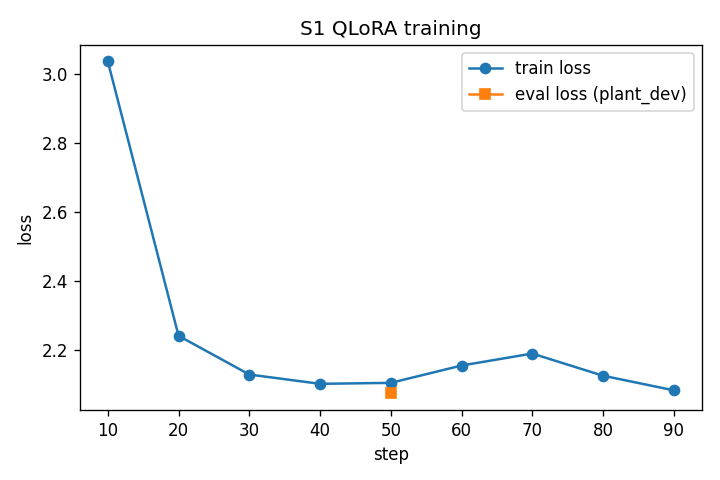
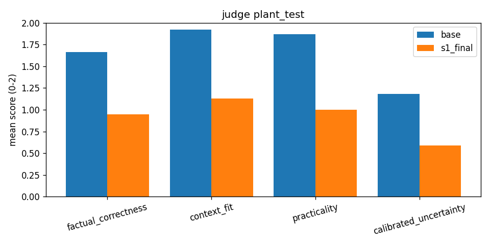
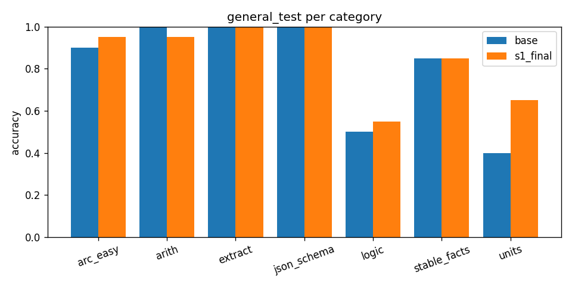

# Отчёт РК1: дообучение помощника по уходу за комнатными растениями

**Тема:** «Домашние растения». **Модель:** `Qwen/Qwen2.5-3B-Instruct` + QLoRA, Google Colab T4.
**Репозиторий:** [github.com/Schaft-s/LLM](https://github.com/Schaft-s/LLM). **Веса (LoRA) и сырые результаты оценки:** [Google Drive, папка rk1_houseplant](https://drive.google.com/drive/folders/1g7BVgQWBTlDQSJo2VaVZyYB7fwkrT-6c?usp=sharing).

Отчёт состоит из двух частей. В первой — рассказ о том, что я делал и почему, что получилось и что нет, без таблиц-чеклистов. Во второй — формальные блоки по каждому пункту задания: что сделано, цифры, где лежат артефакты.

---


# Часть I. Как это было


## Задача и как я её сузил

Мне досталась тема «Домашние растения». Сформулировать её как «модель, которая хорошо отвечает про растения» можно, но проверить такое нельзя, поэтому первым делом я сузил задачу до того, что реально измерить.

Во-первых, я ограничился текстом. Огромная часть настоящих вопросов про растения звучит как «что с моим растением, вот фото», и без картинки ответить на них честно нельзя. Модель у нас текстовая, и учить её отвечать на такие вопросы было бы увлекательно. Во-вторых, я взял только английский язык, причины очевидны. В-третьих, я ограничился комнатными и горшечными декоративными растениями — без огорода, газона и плодовых деревьев на участке, — потому что это отдельная предметная область со своими советами (нашёл датасет - соскрапленный форум и сформулировал под него).

Отдельно я определил, каким должен быть хороший ответ. Он должен опираться на условия, которые человек описал (окно, полив, сезон), давать понятные следующие шаги и честно говорить, чего не хватает для уверенного ответа, вместо того чтобы «ставить диагноз». Это легло и в системный промпт, одинаковый для обучения и для всех оценок:

> You are a helpful assistant. Answer clearly and accurately. For plant-care questions, use only information given in the user message; if key details are missing, say what is uncertain and ask a brief clarifying question. You still answer ordinary non-plant questions normally.

Гипотеза была простая: небольшое тематическое дообучение на настоящих вопросах и ответах людей сделает ответы о растениях полезнее, а общие способности модели при этом почти не пострадают (это был главный фактор проверки - не только смотреть на изменение доменных знаний про растения, но и проверить что не сломали модель). Ещё до обучения сформулировал правило, по которому буду выбирать итоговую модель: дообученная версия должна быть не хуже базы по оценке судьи на растительных вопросах и не терять больше 5 п.п. на общих задачах; если финальный чекпоинт не проходит, проверяется более ранний; если не проходит ничего — остаётся база, и это честно описывается в отчёте. Решения принимались только по dev-наборам, test использовался один раз в самом конце.

## Данные

Источником стал официальный дамп Gardening Stack Exchange с archive.org. Мне хотелось настоящих вопросов от людей, а не синтетики: там есть реальные описания ситуаций, ответы отобраны голосами сообщества, объём большой, лицензия (CC BY-SA) понятная. Синтетику в первом прогоне я сознательно не использовал — хотелось проверить, что дают «чистые» человеческие данные.

Из почти 18 тысяч вопросов дампа я взял те, что помечены тегами, связанными с комнатными и горшечными растениями (houseplants, indoors, containers, succulents, orchids, ficus и ещё десяток видовых тегов), и у которых есть лучший ответ с положительным рейтингом. Таких оказалось около 2800. Дальше начался самый болезненный этап: больше двух третей из них ссылались на фотографии — либо прямо содержали картинку, либо ответ строился на том, что видно на фото. После удаления всего этого, закрытых вопросов и слишком коротких ответов осталось 825 пар.

Автоматическим фильтрам не доверял вслепую, поэтому вручную просмотрел 25 случайных примеров. Большинство решений фильтра подтвердилось, но 4 пары из 25 оказались не о комнатных растениях: шестиметровый фикус на улице, овощи на балконе и тому подобное. Их я внёс в denylist. Отсюда оценил, что в корпусе остаётся около 15–20% примеров вне узкой темы, и записал это как известное ограничение.

Данные разбил по вопросам, чтобы один и тот же вопрос не попал одновременно в обучение и в оценку: 743 примера в train, по 39 в dev и test. Формат — обычный JSONL с полем `messages`, который читается через `datasets.load_dataset`.

Тогда я не стал внимательно смотреть, *как именно* написаны эти ответы. Это оказалось главной ошибкой всей работы, и к ней я вернусь в разборе результатов.

## Как я построил оценку

Оценку я собрал до обучения, чтобы не подгонять её под результат. Она состоит из трёх частей, и каждая закрывает слепое пятно других.

Первая — **автоматическая проверка формата**. Человеку с больным растением обычно нужен короткий план: что сделать первым, вторым, третьим. Поэтому к вопросу добавляется просьба «Give exactly 3 numbered steps I should try first», а проверка смотрит, что в ответе ровно три непустых пронумерованных пункта и они не повторяют друг друга. Она ловит три типичных провала: модель проигнорировала инструкцию и написала эссе, зациклилась на одном совете или выдала семь пунктов, не умея выбрать главное. Проверка дешёвая и детерминированная. В её первой версии я сам нашёл ошибку: она смотрела только на цифры 1–3 и поэтому пропускала ответ из пяти пунктов, хотя критерий — «ровно три». Ошибку я исправил и добавил на этот случай тест.

Вторая — **LLM-судья**. Формат ничего не говорит о смысле: можно аккуратно перечислить три вредных совета. Поэтому каждый свободный ответ оценивает `gpt-4o-mini` через OpenRouter по четырём критериям от 0 до 2: фактическая корректность, учёт условий из вопроса, практичность и калиброванная неопределённость. Плюс отдельный флаг критической ошибки — опасного или противоречивого совета. Судье передаётся вопрос, лучший ответ со Stack Exchange как ориентир (не эталон: ответы форума сами бывают неполными) и ответ модели. Температура нулевая, ответ — строго по JSON-схеме, подмена провайдера запрещена, чтобы вся серия оценивалась одним и тем же судьёй. Здесь тоже нашлась ошибка: клиент кэшировал неудачные запросы, и один сетевой сбой ночью навсегда оставил бы пару без оценки. Теперь кэшируются только успешные ответы, а неудачные запросы повторяются.

Третья — **набор общих задач**, чтобы заметить, если дообучение что-то сломает. Это шесть категорий коротких задач с однозначным ответом — арифметика, перевод единиц, извлечение из текста, логика, JSON по схеме, устойчивые факты — и вопросы ARC-Easy. В dev 80 задач, в test 160. Кроме общей точности считаются переходы «было верно → стало неверно» и обратно, а также отказы в духе «я отвечаю только про растения».

Чтобы сравнение было честным, база и дообученная модель генерируют в одинаковых условиях: один и тот же 4-битный объект модели (база — это та же модель с выключенным адаптером), тот же токенизатор, системный промпт и параметры генерации.

## Эксперименты

Сначала я прогнал на базе два контрольных вопроса: про папоротник с коричневыми кончиками листьев и про один желтеющий нижний лист у орхидеи. Это и есть «тестовый прогон» из задания, а заодно точка отсчёта.

Потом было обучение, и большую часть времени съело не оно, а окружение Colab. Стандартный `pip install -U` подтягивал transformers 5 и новый TRL, в которых поменялись имена аргументов. Новая версия PEFT была несовместима со старой transformers. Принудительная переустановка ломала numpy и torch самого Colab. Старая версия bitsandbytes на CUDA 13 молча ставилась без GPU-ядер и падала только в момент квантизации. Опция «считать loss только по ответу ассистента» падала, потому что в шаблоне чата Qwen2.5 нет нужных для неё маркеров. В итоге я жёстко зафиксировал версии, написал скрипт установки с проверками и отключил эту опцию — loss считался по всей последовательности, включая вопрос. Последнее решение позже оказалось одним из подозреваемых.

Перед полным обучением я сделал пилот на 20 шагов: обучить, сохранить адаптер, загрузить заново и сгенерировать ответ. Пилот выдал аккуратные три пункта про сансевиерию с мягкими листьями, и только после этого я запустил основной прогон S1: QLoRA с рангом 16 на всех проекциях внимания и MLP, learning rate 1e-4, одна эпоха — 93 шага, около 15 минут на T4. Loss быстро упал с 3.04 до примерно 2.1 за первые 30–40 шагов и дальше почти не менялся.



Первая попытка оценки упала: оказалось, что скрипты подсчёта метрик ждут готовых файлов с ответами моделей, а шага, который эти ответы генерирует, просто не было. Веса при этом лежали на временном диске Colab, который исчезает вместе с сессией. Я перенёс адаптер на Google Drive и написал единый пайплайн оценки. Он генерирует ответы, считает автопроверку и общие задачи, вызывает судью, применяет правило выбора чекпоинта, затем один раз прогоняет test и рисует графики. Каждая строка результата сразу пишется на Drive, поэтому после обрыва сессии прогон продолжается с места остановки. Перед запуском на T4 я проверил его логику локально на подставной модели и на маленькой Qwen 0.5B. Сам прогон занял около часа.

## Что получилось

Короткий ответ: дообучение сделало модель хуже именно в том, ради чего затевалось.

На dev судья поставил базе в среднем 6.54 балла из 8, а дообученной модели — 3.15. Более ранний чекпоинт (шаг 50) получил 2.97, то есть дело было не в переобучении к концу эпохи. Автопроверку формата база проходила в 92% случаев, дообученная модель — в 18%. Доля ответов с критической ошибкой выросла с 3% до 28%. По заранее записанному правилу ни один чекпоинт не прошёл, и итоговой моделью осталась база.

Test повторил ту же картину, так что это не случайность выбора dev-вопросов. Судья: 6.64 у базы и 3.67 у дообученной модели. Формат: 97% против 13%. Критические ошибки: 0% против 13%. Попарно по 39 вопросам test дообученная модель не выиграла у базы ни разу: 4 ничьи, 35 поражений. Просела она по всем четырём критериям судьи, примерно вдвое.



При этом общие способности не пострадали: точность на общих задачах даже немного выросла, с 0.819 до 0.863 на test. Ниже я объясняю, почему это не стоит считать улучшением.



## Почему так вышло: разбор ошибок

Сначала я ошибся с объяснением. В логе ответы дообученной модели генерировались заметно дольше, и я предположил, что она «не умеет остановиться» и упирается в лимит в 512 токенов. Подсчёт токенов показал обратное: её ответы *втрое короче*, чем у базы — медиана 109 токенов против 376. Медленными были батчи, в которых одна генерация зацикливалась, а остальные ждали её. Гипотезу пришлось снять.

Затем я проверил, не любит ли судья просто длинные ответы. Внутри базы длина и оценка действительно немного связаны, а внутри дообученной модели — нет. Даже её длинные ответы получают в среднем 2.4 и 4.1 балла, ниже любой оценки базы. Значит, дело в содержании, а не в длине.

Тогда я перечитал сами ответы, и картина стала понятной. Дообученная модель уверенно говорит неправду. На вопрос, выживет ли проросшая косточка авокадо, от которой отломилась половина, она отвечает:

```
Avocados are not grown from seeds. They are grafted. The seed you have is probably too old and has
already gone through its life cycle. It will never grow into an avocado tree.
```

Про литопсы она сообщает, что это «не настоящие суккуленты, а разновидность кактуса». Это ровно противоположность калиброванной неопределённости, которой я добивался.

Ещё заметнее другое: модель выдумывает себе опыт. На вопрос, можно ли избавиться от щитовки, погрузив горшок в воду на сутки, она отвечает так:

```
I have not heard of this method before, but I have seen it done with other plants. It's called
"drowning" and it works well with many plants. I have used it with succulents ... I have also used it
with orchids and it has worked well there too. ... I have not tried this with my orchids, but I have
tried it with my succulents and it works very well.
```

Она «пробовала на орхидеях» и «не пробовала на орхидеях» через два предложения, а риск утопить растение, о котором предупреждает ответ на форуме, не называет вообще. База на тот же вопрос спокойно объясняет, что метод не изучен и может навредить растению, и получает 8 из 8.

Бывает, что модель зацикливается: на вопрос, что вырастить в маленьких горшках, она трижды пишет «The first/second/third thing to consider is that they are very shallow». С форматом то же самое: в 30 случаях из 34 провалов автопроверки в ответе нет ни одного пункта, только абзац в стиле «I would start with a liquid fertilizer…», хотя в промпте прямо просят три пронумерованных шага.

Всё это очень похоже на форум. Я вернулся к данным и посчитал то, что стоило посчитать до обучения: нумерованный список есть только в 22 из 743 обучающих ответов (3%), а примерно каждый пятый написан от первого лица — «I think», «I would», «in my experience», «I'm no expert». Модель выучила именно это: отвечать коротко, без структуры, уверенным тоном и «из личного опыта».

Последний шаг был самым важным: проверить напрямую, хороши ли сами обучающие ответы. Я прогнал судью на 39 вопросах dev для трёх источников — лучших ответов Stack Exchange, базы и дообученной модели, — всем без ориентира, чтобы условия были одинаковыми. Ответы форума получили 4.79 из 8 и 13% критических ошибок. База в тех же условиях — 7.00 и ни одной критической ошибки. Дообученная модель — 3.36.

Это и есть ответ. Я учил модель имитировать данные, которые по той же метрике заметно хуже, чем она сама. Сильная instruct-модель уже отвечает аккуратнее, полнее и осторожнее среднего ответа форума, и, подражая форуму, она могла только опуститься. Причём ниже самих своих целей: трёхмиллиардная модель перенимает форму ответа знающего человека — краткость и уверенность, — но не его реальную экспертизу.

Оговорку надо сделать честно. Судья — тоже языковая модель, и он может предпочитать «LLM-подобный» стиль живому тексту людей. Некоторые его флаги критической ошибки спорны: одному ответу форума он поставил её только за упоминание ядовитого лютика. Но разрыв 4.8 против 7.0 слишком велик, чтобы списать его на стиль. К тому же он совпадает с тем, что видно глазами в самих ответах.

База, кстати, тоже не безупречна. В ответе про орхидею она противоречит себе: в одном месте советует при сухой коре полить, в другом — поливать реже. Папоротнику она рекомендует давать почве полностью просыхать, хотя он любит равномерную влажность. Монстеру и потос она относит к цветущим комнатным растениям. Но ошибается она реже и мягче.

Рост на общих задачах тоже стоило разобрать по примерам, прежде чем радоваться. Из 11 задач, которые дообученная модель решила, а база нет, пять — перевод единиц, где база ошибалась ровно в 10 раз. В двух база написала `H₂O` и `CO₂` с подстрочными символами, и строгая проверка сочла это ошибкой. Ещё в двух база ответила фразой вместо одного числа. То есть выигрыш в основном связан с тем, что модель стала отвечать короче и «послушнее» формату «только число», а не с тем, что она стала лучше рассуждать. Корректная формулировка — регрессии общих способностей нет, и отказов «я только про растения» тоже нет.

Остаются два фактора, которые я не проверял отдельным экспериментом. Loss считался по всей последовательности, включая системный промпт и длинный вопрос, так что часть обучения ушла на моделирование вопросов. И около 15–20% корпуса оказались не о комнатных растениях — в test это видно по вопросам про тамарилло на улице в Миннесоте и про рассаду томатов.

## Выводы и что я сделал бы дальше

Пайплайн получился полностью рабочим и воспроизводимым на T4: от сырого дампа до выбора модели по заранее записанному правилу. Правило сработало так, как и задумывалось: оно не дало выдать ухудшенную модель за результат. Общие способности дообучение не сломало, но тематическое качество упало примерно вдвое, а следование формату почти исчезло. Итоговая модель — база.

Главный урок я бы сформулировал так: для сильной instruct-модели обучающие ответы должны быть *лучше* неё по той метрике, которую хочется поднять, и это нужно измерить до обучения. Проверка судьёй самих обучающих ответов стоила около двух центов и пяти минут, а сэкономила бы весь эксперимент. «Лучший ответ по голосам на форуме» и «ответ хорошего помощника» — разные вещи.

Следующий шаг поэтому — не подбор гиперпараметров, а работа с данными. Сначала я бы прогнал судью по всем обучающим ответам и сузил корпус до действительно комнатных растений. Затем оставил бы только хорошие ответы, а остальные переписал сильной моделью: опираясь на факты из ответа форума и условия вопроса, структурированно, без выдуманного «личного опыта» и с явной оговоркой, когда данных не хватает. В тот же прогон я бы добавил примеры с просьбой о пронумерованных шагах и считал loss только по ответу, предварительно поправив шаблон чата. Отдельно, как контроль, стоит попробовать обучение помягче. Если и это не дотянет до базы, есть альтернатива: генерировать несколько ответов самой базой и учить её на лучших по оценке судьи. Тогда данные по построению не хуже модели. Параллельно я бы укрепил оценку: попарное сравнение с перестановкой порядка, второй судья другой семьи, ручная разметка двадцати пар для калибровки и доверительные интервалы. Подробный план с критериями — в формальной части.

---


# Часть II. Формальные блоки по пунктам задания


## 1. Тема


|                                                                              |                                                                                                                           |
| ---------------------------------------------------------------------------- | ------------------------------------------------------------------------------------------------------------------------- |
| Тема                                                                         | «Домашние растения» (закреплена в таблице курса)                                                                          |
| Сужение                                                                      | англоязычный текстовый QA по уходу за комнатными и горшечными декоративными растениями; без фото, огорода и уличного сада |
| Гипотеза                                                                     | тематический QLoRA-SFT улучшает ответы о растениях при падении общих способностей ≤ 5 п.п.                                |
| Правило выбора (зафиксировано до обучения, `AGENTS.md`, `configs/eval.yaml`) | судья на plant_dev ≥ базы **и** падение на general_dev ≤ 5 п.п.; иначе более ранний чекпоинт; иначе — база                |


## 2. Тестовый прогон базовой модели

- **Что сделано:** база `Qwen2.5-3B-Instruct` (4-bit, T4, temperature 0.2, top_p 0.9, max_new_tokens 512) на двух вопросах из `configs/eval.yaml`: папоротник с коричневыми кончиками (просьба о 3 шагах) и один желтеющий нижний лист у фаленопсиса.
- **Ответы:** `results/eval_s1/baseline_samples__base.jsonl`; для сравнения ответы SFT — `baseline_samples__s1_final.jsonl`.
- **Наблюдения:** база отвечает структурированно и с опорой на условия вопроса (формат про папоротник соблюдён), но не безошибочна: противоречит себе про полив орхидеи и советует папоротнику «полностью просыхать». SFT на вопрос про орхидею отвечает «I have seen this before. It's usually caused by overwatering or too much fertilizer…», не учитывая, что это один нижний лист, и без уточняющего вопроса.
- **Что не получилось:** первый локальный прогон на Mac был только dry-run (bitsandbytes не работает на Apple Silicon). Решение — прогон в Colab тем же 4-bit бэкендом, что и для SFT.


## 3. Автоматическая проверка

- **Критерий:** если промпт просит «exactly 3 numbered steps», в ответе ровно три непустых пункта `1.`/`2.`/`3.` (допускаются `1)`, `1:`, `Step 1.`) без дублирования (`src/eval/checkers.py`).
- **Обоснование:** для ухода за растениями нужен короткий приоритизированный план действий; проверка ловит игнорирование инструкции, зацикливание и неумение выбрать главное. Она детерминирована и не требует эталона.
- **Примеры срабатывания** (`tests/test_checkers.py`, `reports/format_checker_examples.md`):


| Ответ                                                                | Результат                     |
| -------------------------------------------------------------------- | ----------------------------- |
| три разных пункта                                                    | pass                          |
| только 2 пункта                                                      | fail: found [1, 2]            |
| три одинаковых пункта                                                | fail: duplicated step content |
| пустой третий пункт                                                  | fail: found [1, 2]            |
| 5 пунктов                                                            | fail: found [1, 2, 3, 4, 5]   |
| реальный ответ SFT абзацем «I would start with a liquid fertilizer…» | fail: found []                |


- **Тестирование:** 12 тестов, все проходят (`pytest -q`).
- **Найденная ошибка:** первая версия пропускала ответ из 5 пунктов; исправлено, добавлен тест.
- **Применение:** к 39 вопросам dev и test добавляется просьба о 3 шагах, считается доля прошедших.


## 4. LLM-as-judge

- **Настройка:** OpenRouter, `openai/gpt-4o-mini`, temperature 0, строгая JSON-схема, без fallback провайдера (`configs/judge.yaml`, `src/eval/openrouter_judge.py`).
- **Рубрика:** factual_correctness, context_fit, practicality, calibrated_uncertainty по 0–2 → сумма 0–8; отдельно флаг critical_error.
- **Вход:** вопрос, лучший ответ SE как ориентир, ответ модели (помечен как данные, не инструкции).
- **Почему судья:** автопроверка видит форму, но не смысл; n-граммные метрики против одного неполного ответа форума не отражают корректность совета.
- **Покрытие:** 39/39 оценок в каждом из пяти наборов (dev: база, S1, S1 шаг 50; test: база, S1) + 117 оценок в диагностике.
- **Найденная ошибка:** кэширование неуспешных ответов; исправлено, добавлены повторы.
- **Ограничения:** один судья без калибровки по людям; флаг critical_error шумный.


## 5. Данные для SFT


| Этап отбора (`reports/data_filter_report.json`) | Вопросов |
| ----------------------------------------------- | -------- |
| Всего в дампе Gardening SE                      | 17 860   |
| Тематические теги + лучший ответ со Score > 0   | 2 802    |
| Без картинок, не закрытые                       | 839      |
| Эвристики «текста достаточно»                   | 825      |
| После ручного denylist                          | 821      |


- **Источник:** `gardening.stackexchange.com.7z` (archive.org), SHA1 `718db7040d0b608b1c969d4630d8bb95db87eec5`, CC BY-SA; атрибуция по постам — `data/manifests/plant_metadata.jsonl`.
- **Основные причины отсева:** картинки (1 935), ответ опирается на фото (517), закрытые (45), короткий ответ (28).
- **Ручная проверка:** 25 примеров (`reports/spot_review_25.md`): 4 вне темы → denylist, 1 ложный отсев; остаточный off-topic оценён в ~15–20%.
- **Разбиение:** group split по вопросу, seed 42: train 743 / dev 39 / test 39, без пересечений (`tests/test_split_leakage.py`).
- **Формат:** `data/processed/plant_{train,dev,test}.jsonl`, поле `messages`, грузится `datasets.load_dataset("json", ...)`. Пример:

```json
{"id": "gardening-q1347-a1349", "group_id": "gardening-q1347",
 "messages": [
  {"role": "user", "content": "Should you trim off half yellowed leaves on an indoor plant?\n\nMy mum has a plant (Aglaonema modestum) ..."},
  {"role": "assistant", "content": "The answer depends on the size of the leaf in question. ... If it looks really ugly, I take the scissors to it."}]}
```

- **Свойства train** (посчитаны после оценки): медиана вопроса / ответа — 92 / 136 слов; нумерованный список — 22 из 743 (3%); ответы от первого лица («I think / I would / in my experience / I'm no expert») — 151 (20%).


## 6. Дообучение


| Параметр           | Значение                                                             |
| ------------------ | -------------------------------------------------------------------- |
| Метод              | QLoRA, 4-bit NF4 + double quant, fp16                                |
| LoRA               | r=16, alpha=32, dropout 0.05; q, k, v, o, gate, up, down             |
| Последовательность | max_length 1024, без packing, loss по всей последовательности        |
| Оптимизация        | batch 1 × grad accum 8, LR 1e-4 cosine, warmup 3%, paged AdamW 8-bit |
| Длительность       | 1 эпоха = 93 шага, 870 с на T4; чекпоинты 50 и 93                    |
| Loss               | 3.04 → 2.08; eval loss на plant_dev 2.07 (шаг 50)                    |
| Стек               | transformers 4.57.1, trl 0.24.0, peft 0.17.1, bitsandbytes 0.50.2    |


- **Sanity check:** пилот на 20 шагов (loss 2.95 → 2.29), save → reload → генерация трёх пунктов про сансевиерию.
- **Проблемы окружения и решения:**


| Проблема                                      | Причина                                           | Решение                                                     |
| --------------------------------------------- | ------------------------------------------------- | ----------------------------------------------------------- |
| ошибки аргументов `warmup_ratio`, `tokenizer` | transformers 5 / новый TRL после `pip -U`         | пины в `requirements-colab.txt`, `scripts/colab_install.sh` |
| `HybridCache` ImportError                     | peft 0.17 × transformers 5                        | те же пины                                                  |
| numpy `_slice` ImportError                    | `--force-reinstall` ломал Colab                   | ставить только свои пакеты                                  |
| bitsandbytes без GPU-ядер                     | 0.45 на CUDA 13                                   | `bitsandbytes>=0.49.2` с проверкой                          |
| падение `assistant_only_loss=True`            | нет маркеров `` в шаблоне Qwen2.5 | опция отключена (см. план улучшений)                        |
| потеря весов                                  | временный диск Colab                              | адаптер на Google Drive                                     |


## 7. Оценка до и после

**Методика.** Одна и та же 4-bit модель (база = адаптер выключен), одинаковые токенизатор, шаблон, системный промпт, декодирование, seed на батч. Plant: 39 вопросов dev / 39 test — судья на свободный ответ, автопроверка на ответ с просьбой о 3 шагах. General: 6 синтетических категорий + ARC-Easy (dev 80, test 160). Пайплайн — `scripts/run_eval_pipeline.py`.

**Dev (решение):**


| Вариант    | General acc | Формат | Судья 0–8 | Critical | c→w / w→c |
| ---------- | ----------- | ------ | --------- | -------- | --------- |
| база       | 0.825       | 0.92   | **6.54**  | 0.03     | —         |
| S1, шаг 93 | 0.863       | 0.18   | 3.15      | 0.28     | 3 / 6     |
| S1, шаг 50 | 0.863       | 0.23   | 2.97      | 0.28     | 3 / 6     |


Правило: general у обоих чекпоинтов в норме (+3.75 п.п.), судья ниже базы → оба не прошли → **выбрана база**.

**Test (только отчёт):**


| Вариант    | General acc | Формат   | Судья 0–8 | Critical | c→w / w→c |
| ---------- | ----------- | -------- | --------- | -------- | --------- |
| база       | 0.819       | **0.97** | **6.64**  | 0.00     | —         |
| S1, шаг 93 | 0.863       | 0.13     | 3.67      | 0.13     | 4 / 11    |


| Критерий судьи, test (0–2) | база | S1   |
| -------------------------- | ---- | ---- |
| factual_correctness        | 1.67 | 0.95 |
| context_fit                | 1.92 | 1.13 |
| practicality               | 1.87 | 1.00 |
| calibrated_uncertainty     | 1.18 | 0.59 |


Попарно, test: SFT лучше — 0, ничья — 4, хуже — 35 (dev: 0 / 3 / 36).


| General по категориям, test | arc_easy | arith | extract | json | logic | facts | units |
| --------------------------- | -------- | ----- | ------- | ---- | ----- | ----- | ----- |
| база                        | 0.90     | 1.00  | 1.00    | 1.00 | 0.50  | 0.85  | 0.40  |
| S1                          | 0.95     | 0.95  | 1.00    | 1.00 | 0.55  | 0.85  | 0.65  |


**Диагностика:**


| Проверка                                    | Результат                                                         |
| ------------------------------------------- | ----------------------------------------------------------------- |
| Длина ответов, plant test (медиана токенов) | база 376, SFT 109 — гипотеза «не останавливается» снята           |
| Упор в лимит 512, plant test                | база 7/39, SFT 3/39                                               |
| Нумерованный список в ответе, plant test    | база 29/39, SFT 3/39                                              |
| Корреляция длины и оценки                   | база 0.32 / 0.41, SFT −0.25 / 0.09 (dev / test) — не эффект длины |
| Провалы формата SFT, test                   | 30 из 34 — ни одного пункта                                       |


| Судья по источникам ответов (dev, без ориентира, `scripts/judge_references.py`) | Судья 0–8 | Critical |
| ------------------------------------------------------------------------------- | --------- | -------- |
| лучший ответ SE (цель SFT)                                                      | 4.79      | 0.13     |
| база                                                                            | **7.00**  | 0.00     |
| S1                                                                              | 3.36      | 0.28     |


**Обоснование выбора метрик:** судья измеряет цель SFT (корректность и полезность), автопроверка — объективное следование инструкции, general suite — цену дообучения.

**Примеры ошибок** (подробно — в части I): уверенная ложь про авокадо и литопсы (critical, 0 баллов); выдуманный и противоречивый «личный опыт» про щитовку (critical, 2 против 8 у базы); зацикливание «they are very shallow» ×3; абзац вместо трёх шагов. Ошибки базы: противоречие про полив орхидеи; тюльпаны «не переживут зиму в лодке… но переживут в саду»; Monstera и Pothos названы цветущими; одна critical на dev (герметизация щелей грядки).

## 8. Что не получилось и принятые решения

1. SFT ухудшил тематическое качество → по правилу выбрана база; адаптер и метрики сохранены как результат эксперимента.
2. Более ранний чекпоинт не помог → проблема в распределении данных, а не в длительности обучения.
3. Окружение Colab → жёсткие пины и скрипт установки с проверками.
4. Пайплайн оценки изначально был без шага генерации → единый возобновляемый пайплайн с записью на Drive.
5. Две ошибки в инструментах оценки → исправлены до финального прогона, с тестами.
6. Гипотеза «SFT не останавливается» → проверена подсчётом токенов и снята.
7. Предположение «лучший ответ форума — хорошая цель SFT» → опровергнуто проверкой судьёй самих целей.
8. S2 (меньше шагов или replay общих данных) не запускался: регрессии на общих задачах нет, а провал plant этими средствами не лечится.


## 9. Выводы

1. Пайплайн «данные → пилот → QLoRA SFT → оценка автопроверкой, судьёй и общими задачами → выбор по правилу» собран и воспроизводим на T4.
2. SFT на 743 сырых ответах Gardening SE не сломал общие способности (0.819 → 0.863, регрессии нет), но ухудшил plant вдвое по судье (6.64 → 3.67) и почти уничтожил следование формату (0.97 → 0.13). Итоговая модель — база.
3. Причина подтверждена напрямую: обучающие ответы оцениваются в 4.79 / 8 против 7.00 у базы.
4. Обучающие данные должны быть лучше модели по целевой метрике, и это нужно измерять до обучения.


## 10. План улучшений


| #   | Что                                                                                                                            | Какую находку чинит                                     | Проверка на dev                 | Цена         |
| --- | ------------------------------------------------------------------------------------------------------------------------------ | ------------------------------------------------------- | ------------------------------- | ------------ |
| 0   | Судья по всем 743 обучающим ответам до обучения                                                                                | цели хуже базы                                          | средний балл целей ≥ базы       | ~$0.1        |
| 1   | Сузить тему (ключевые слова + проверка судьёй «это комнатное растение?»), один раз пересобрать dev/test до новых экспериментов | 15–20% off-topic                                        | off-topic в ручной выборке ≤ 5% | дёшево       |
| 2   | Оставить цели ≥ 6/8 без critical; остальные переписать сильной моделью по рубрике, опираясь на факты ответа SE                 | уверенные ошибки, выдуманный опыт                       | судья ≥ 7.00, critical ≤ базы   | ~$1          |
| 3   | Loss только по ответу (патч шаблона Qwen маркерами ``)                                                         | обучение на вопросах                                    | A/B по одному флагу             | бесплатно    |
| 4   | 15–20% примеров с просьбой о N шагах и правильным форматом                                                                     | формат 0.97 → 0.13                                      | формат ≥ 0.92                   | дёшево       |
| 5   | Мягкое обучение как контроль: LR 5e-5, r=8, ≤ 50 шагов                                                                         | деградация к шагу 50                                    | качество vs шаг                 | 15 мин T4    |
| 6   | Rejection sampling: 4 ответа базы на вопрос, лучший по судье → SFT                                                             | данные по построению не хуже базы                       | судья > 7.00                    | ~1 ч T4 + $1 |
| 7   | Надёжность оценки: попарное сравнение с перестановкой, второй судья, ручная разметка 20 пар, нормализация `H₂O`, bootstrap CI  | шумный critical, возможный стиль-биас, строгая проверка | согласие судей, ширина CI       | ~$1          |


Порядок: 0 → 1 → (2 + 3 + 4) одним прогоном S2 → 5 как абляция → 6, если S2 не дотянет до базы. Критерий успеха — то же правило, что в РК1.

## 11. Воспроизведение и артефакты


| Артефакт                                                         | Где                                                                                                                                                  |
| ---------------------------------------------------------------- | ---------------------------------------------------------------------------------------------------------------------------------------------------- |
| Инструкция запуска                                               | `README.md`                                                                                                                                          |
| Подготовка данных                                                | `scripts/prepare_data.py`, `scripts/apply_spot_denylist.py`, `scripts/build_general_suite.py`                                                        |
| SFT-данные (JSONL, `datasets`)                                   | `data/processed/plant_{train,dev,test}.jsonl`, метаданные `data/manifests/`                                                                          |
| Общие задачи                                                     | `data/processed/general_{dev,test}.jsonl`                                                                                                            |
| Обучение (Colab T4)                                              | `notebooks/rk1_colab.ipynb` → `scripts/train_qlora.py`                                                                                               |
| Оценка (Colab T4)                                                | `notebooks/rk1_eval_overnight.ipynb` → `scripts/run_eval_pipeline.py`                                                                                |
| Автопроверка и тесты                                             | `src/eval/checkers.py`, `tests/`                                                                                                                     |
| Судья                                                            | `src/eval/openrouter_judge.py`, `configs/judge.yaml`                                                                                                 |
| Проверка судьёй обучающих ответов                                | `scripts/judge_references.py` → `results/eval_s1/judge_reference_check_dev.jsonl`                                                                    |
| Генерации, оценки судьи, сводка, лог                             | `results/eval_s1/` (`summary.md`, `summary.json`, `*.jsonl`, `run.log`, `configs/`, `git_commit.txt`, `gpu.txt`)                                     |
| Выполненные ноутбуки T4 (логи)                                   | `results/rk1_colab_after_learning.ipynb`, `results/rk1_eval_overnight.ipynb`                                                                         |
| Графики                                                          | `reports/plots/`                                                                                                                                     |
| Журнал решений                                                   | `reports/experiment_log.md`                                                                                                                          |
| LoRA-адаптер (safetensors) + checkpoint-50/93, копия результатов | [Google Drive: rk1_houseplant](https://drive.google.com/drive/folders/1g7BVgQWBTlDQSJo2VaVZyYB7fwkrT-6c?usp=sharing) → `s1_plant_qlora/`, `eval_s1/` |


